# Apex ERP RFQ Suite — Technical Document

> **Status:** Complete draft for review — Parts A–D (Sections 0–15).
> **Baseline:** Git commit `b6b8664` **plus uncommitted work from 2026-11-16** (17 modified files, untracked migrations `backend/rfq/migrations/0006`–`0008`). See TD-07 and TC-C1.
> **Evidence labels:** **[Verified]** = read in code/config or seen in a command output · **[Inferred]** = a conclusion drawn from verified facts, not directly observed · **[To confirm]** = not answerable from the repository; listed in the To-confirm table at the end of each part.

---

## 0. Document control

| Item | Value |
|---|---|
| Title | Apex ERP RFQ Suite — Technical Document |
| System | Apex ERP RFQ Suite (product name shown in the app sidebar, `src/components/layout/Sidebar.tsx:44`) for **[Client name]** |
| Document version | 0.4 (draft) |
| Status | Complete draft — for review |
| Source baseline | Git commit `b6b8664` ("Add RFQ outsourced process cost calculations"), 2026-11-16, repository `Pricing_tool/` (55 commits since 2026-09-15), **plus uncommitted changes in 17 files and 3 untracked migrations present in the working tree** (see Part C baseline note, TD-07) [Verified: `git log`, `git status`] |
| Authors | [Author name], [Author name] |
| Reviewers | [Technical reviewer], [Client IT reviewer], [Management reviewer] |
| Approver | [Approver name] |
| Classification | Internal / Client confidential — [To confirm] |

### 0.1 Revision history

| Version | Date | Author | Change |
|---|---|---|---|
| 0.1 | 2026-11-16 | [Author name] | Part A drafted: document control, executive summary, scope, business context. |
| 0.2 | 2026-11-16 | [Author name] | Part B drafted: architecture, detailed design, endpoint tables, runbook comparison, data design. Corrected two line references in 3.2.2. |
| 0.3 | 2026-11-16 | [Author name] | Part C drafted: code quality (measured), security review, STRIDE, evaluator review; companion register `Tech_Debt_and_Security_Register.md`; baseline corrected to include uncommitted changes. |
| 0.4 | 2026-11-16 | [Author name] | Part D drafted: hosting and deployment (D4, runbook, rollback, gap checklist), operations, non-functional requirements, risk table, decision log, roadmap, appendices, consolidated To-confirm list, final summary. |

### 0.2 How to read this document

| Reader | Start with |
|---|---|
| New developer | Sections 3, 4, 5, 6, Appendix 15 |
| Client IT | Sections 1, 4, 6, 8, 9, 10 |
| Management | Sections 1, 3, 12, 14 |
| Reviewer / auditor | Sections 3.4, 7, 8, 12, the To-confirm tables, and `Tech_Debt_and_Security_Register.md` |

### 0.3 Method

Every statement was taken from the source code, configuration, existing project documents, or a command run on 2026-11-16. Source code was not modified. The production configuration file `backend/.env` was **not** opened; only setting names from `backend/.env.example` and `backend/config/settings.py` are used. The only request made to the live system was one `curl -I https://pricing.nxsys.in` (headers only).

---

## 1. Executive summary

> **TL;DR**
> - The Apex ERP RFQ Suite replaces the client's Excel pricing workbook with a web application that takes an industrial pulley RFQ from intake to a signed quotation through six roles.
> - It is a Django REST API plus a React single-page app; the live site at `pricing.nxsys.in` answers over HTTPS from an Nginx server on Ubuntu.
> - The core workflow is built and enforced on the server, but several endpoints skip permission checks, backups are unverified, and the delivery-date requirement is not yet linked to RFQs.

### 1.1 What the system does

The system manages the request-for-quotation (RFQ) lifecycle for drum and drive pulleys [Verified: `REQUIREMENTS_DOCUMENT.md` §1]:

1. **Sales** records the customer's request and fills in a Technical Data Sheet for each pulley.
2. **Operations** checks feasibility.
3. **Sourcing** decides, per process, whether work is done in-house, outsourced or handled as logistics, and sets costs.
4. **Controlling** adds freight, duties, discount, margin and tax.
5. **Approval Panel** approves, sends back or rejects.
6. **Sales** generates the quotation (on-screen preview and PDF), emails it, and records Won or Lost.

The cost of each pulley is calculated by a **formula engine** whose formulas, fields and rates are stored in the database and edited on the Formulas, Cost Rate Tables, catalog and In-House Hours pages, so pricing logic can change without a code release [Verified: `backend/formulas/models.py`, `src/lib/pulleyTechDataCalc.ts`].

### 1.2 Who uses it

| User group | Access |
|---|---|
| Sales, Operations, Sourcing, Controlling, Approval Panel | Their own stage of the workflow, plus read access to shared data (Section 3.3) |
| Admin | Everything, plus Users & Roles, Settings and Audit Log |
| Customer | No login. Receives the quotation by email (Section 4, D1) |

### 1.3 Current state (2026-11-16)

| Area | State | Label |
|---|---|---|
| Live site | `https://pricing.nxsys.in` returns HTTP 200; header `Server: nginx/1.24.0 (Ubuntu)` | [Verified: `curl -I`] |
| Last frontend deployment | The served `index.html` has `Last-Modified: Fri, 30 Oct 2026` | [Inferred from header] |
| Production database | Neon PostgreSQL according to `DEPLOYMENT_RUNBOOK.md` | [To confirm] |
| Backend apps | `accounts`, `formulas`, `reference`, `rfq`, `delivery` | [Verified: `backend/config/settings.py` `INSTALLED_APPS`] |
| Workflow enforcement | Stage order, send-back targets and rejectable stages are re-checked on the server | [Verified: `backend/rfq/workflow.py`] |
| Delivery schedule | A single company-wide schedule with critical-path calculation; **not linked to any RFQ** | [Verified: `backend/delivery/models.py:24`] |
| Version control | Git repository, 55 commits since 2026-09-15; no CI configuration found | [Verified: `git log`, file listing] |
| Local development data | SQLite file with 8 RFQs, 100 formulas, 150 sheet fields (development data, not production) | [Verified: query on `backend/db.sqlite3`] |

### 1.4 Top 5 risks (preliminary — full analysis in Parts C and D)

| # | Risk | Evidence | Severity (preliminary) |
|---|---|---|---|
| R1 | Quotation endpoints have no role or stage check: any signed-in user can generate a quotation from any stage, mark it sent, or set Won/Lost | `backend/rfq/views.py:885` (`generate_quotation`), `:911` (`send_quotation`), `:260` (`update_status`) | High |
| R2 | When an RFQ is moved to the next stage, the screen sends "save" and "advance" requests at the same time without waiting. If the advance is processed first, the save is rejected — Controlling's cost breakdown could be lost | `src/features/rfq/ControllingScreen.tsx:139-144` (same pattern in Operations and Sourcing screens) | High [Inferred — not reproduced] |
| R3 | Backups, restore testing and disaster recovery are not documented for the database or the uploaded attachments (`backend/media/`) | `DEPLOYMENT_RUNBOOK.md` has no backup section | High [To confirm] |
| R4 | The frontend decides what to show from hard-coded role names, while the backend uses an editable permission grid. After an Admin edits the grid, screens and API disagree | `src/components/layout/navConfig.ts`, `src/lib/workflow.ts:105`, `backend/accounts/role_permissions.py` | Medium |
| R5 | The audit trail is readable by every signed-in user, the "user" written to it is taken from the request body, and audit records can be edited in Django admin | `backend/rfq/views.py:224-226`, `:329-334`, `backend/rfq/admin.py:51` | Medium |

---

## 2. Scope

> **TL;DR**
> - This document covers the code in the `Pricing_tool` repository (backend and frontend) and its production deployment at `pricing.nxsys.in`.
> - It describes the system as built at commit `b6b8664`; it does not redesign it or fix defects.
> - Hosting facts that cannot be read from the repository are marked [To confirm].

### 2.1 Goals of this document

1. Give new developers an accurate map of the code, data and calculations.
2. Give the client's IT and management a clear view of architecture, hosting, risks and open decisions.
3. Give reviewers and auditors traceable evidence (file and line) for every claim.

### 2.2 Non-goals

- Changing code, configuration, migrations or tests. Defects are recorded, not fixed.
- Restating the business requirements; `REQUIREMENTS_DOCUMENT.md` remains the requirements source and is cross-referenced in Section 3.5.
- Documenting the earlier frontend-only prototype on Vercel (`vercel.json`, `PROTOTYPE_GUIDE.md`) except where it explains current behaviour.
- User training material (see `WORKFLOW_WALKTHROUGH.md`; parts of it describe the old prototype — see Section 3.6).

### 2.3 Assumptions

| # | Assumption | Label |
|---|---|---|
| A1 | The code at commit `b6b8664` is what is deployed in production. | [To confirm] |
| A2 | Production uses `DEBUG=false` and a `DATABASE_URL` pointing to PostgreSQL, as `DEPLOYMENT_RUNBOOK.md` instructs. | [To confirm] |
| A3 | Formulas and rates come from the client workbook `Sample _Drum_Drive_Pulley_Pricing Tool.xlsx`. | [Verified: `REQUIREMENTS_DOCUMENT.md` §8; comments in `src/data/pulleyCostRates.ts`] |
| A4 | Currency is INR, with EUR as a reference conversion. | [Verified: `REQUIREMENTS_DOCUMENT.md` §8; `exchangeRateEurToInr` in `src/data/pulleyCostRates.ts`] |

### 2.4 Constraints

| Constraint | Source |
|---|---|
| Backend: Python, Django 6.1.1, Django REST Framework 3.18.1 | `backend/requirements.txt` [Verified] |
| Frontend: React 19, React Router 7, Zustand 5, Vite 8, TypeScript ~6.0 | `package.json` [Verified] |
| Formulas must be valid on both the Python and the TypeScript evaluator, so they use `pow()` and `iff()` instead of `**` and `?:` | `backend/formulas/evaluator.py` docstring; `src/lib/formulaEval.ts` header [Verified] |
| Production shares a VPS with other applications; this app uses internal port 8012 | `DEPLOYMENT_RUNBOOK.md` [To confirm] |
| Unanswered client questions on material rates, outsourced costs and delivery lead times | `CLIENT_CLARIFICATION_QUESTIONNAIRE.md` [Verified] |

### 2.5 Glossary

| Term | Meaning in this system |
|---|---|
| RFQ | Request for Quotation — one customer enquiry, holding one or more pulley **items**. |
| Item / pulley | One line of an RFQ (`RFQItem`), with its own Technical Data Sheet and cost. |
| Technical Data Sheet (TDS) | The per-pulley specification form: dimensions, hub, shaft, bearings, lagging, locking device. |
| Stage | Where an RFQ is in the workflow (Draft … Won/Lost/Rejected). See Section 3.2. |
| Stage owner | The role that must act while an RFQ is in a stage. |
| Send back | Return an RFQ to an earlier stage, with a comment. |
| Reject | End an RFQ permanently (stage `Rejected`), with a reason and comment. |
| Sourcing | Deciding per process whether work is **In-house**, **Outsource** or **Logistics**, and its cost. |
| Bought-out component | A purchased part priced from a catalog: bearing, adapter sleeve, housing, lagging, locking device. |
| Controlling | The commercial pricing stage: freight, duties, discount, margin %, tax %. |
| Pricing Tool | The page and calculation that build a pulley's cost in Sections A–F. |
| Sections A–F | A raw materials · B ancillary (bought-out) parts · C in-house processing · D outsourced processing · E packing and shipment · F summary (total direct cost, list price, net price, price incl. GST, margin). |
| Formula engine | The restricted expression evaluator that calculates Auto fields and Sections A–F. |
| Auto field / Manual field | A sheet field calculated by a formula / typed in by the user. |
| Copy formula | An Auto field whose formula is a single field key; it copies that value as-is. |
| Fixed value | A default value set on the Formulas page and pre-filled on every RFQ. |
| Cost Rate Tables | Global parameters, material, labour and logistics rates used as formula variables. |
| MHR | Machine Hour Rate — INR per hour for an in-house operation (In-House Hours page). |
| LHR | Labour Hour Rate. The page formerly called "MHR & LHR Calculator" is now "In-House Hours" (`src/App.tsx` route `/in-house-hours`). |
| In-House Hours | Run and setup minutes per pulley per operation (c1, c2, …), costed at the MHR rate; feeds Section C. |
| Raw Forging Prices | Shaft and shell material rate bands. |
| OEM discount, markup (price factor), GST | Global parameters used in Section F (list price = direct cost × markup; net = list × (1 − OEM discount); incl. GST = net × (1 + GST)). |
| Critical path (CPM) | The longest chain of dependent activities in the Delivery Schedule; sets total days. |
| Safety factor | Multiplier applied to delivery weeks (default 1.2). |
| Permission grid | Per-role table of modules × actions (view, create, edit, delete). See Section 3.3. |
| Module | One of six permission areas: Create RFQ, Operations Review, Sourcing, Costing, Approval, Masters. |
| SLA | Service Level Agreement. Here: target days per stage on the Settings page — stored, **not enforced** (`backend/reference/models.py`, comment "informational SLA targets, not yet enforced"). |
| Incoterms | International delivery terms (e.g. FOR Destination) recorded on the RFQ. |
| DRF | Django REST Framework. |
| Neon | A managed PostgreSQL service, named in the runbook as the production database. |
| VPS | Virtual Private Server. |
| RPO / RTO | Recovery Point Objective (maximum data loss) / Recovery Time Objective (maximum downtime). |

---

## 3. Business context

> **TL;DR**
> - Six roles move an RFQ through eight forward stages; four stages can send back or reject.
> - The server enforces stage order and who may act, using an editable per-role permission grid; the browser uses fixed role names to show menus and buttons.
> - Most requirements in `REQUIREMENTS_DOCUMENT.md` are implemented; the per-RFQ delivery date, real "reset to baseline" and some server-side checks are missing or partial.

### 3.1 Users and roles

Roles are fixed in code: `Sales`, `Operations`, `Sourcing`, `Controlling`, `Approval Panel`, `Admin` [Verified: `backend/accounts/models.py:5`]. Each user has exactly one role. A Django superuser is always saved as `Admin` [Verified: `backend/accounts/models.py:22`].

| Role | Owns stage(s) | Main screens (menu visibility from `src/components/layout/navConfig.ts`) [Verified] |
|---|---|---|
| Sales | Draft, Approved, Quotation Generated, Quotation Sent | RFQs, Quotations, Pricing Tool, Bearing & Sleeve Data, Delivery Schedule, Customers, Products |
| Operations | Operations Review | RFQs, My Tasks |
| Sourcing | Sourcing | Sourcing list, Raw Forging Prices, Bearing & Sleeve Data, Delivery Schedule, In-House Hours, Vendors, Products |
| Controlling | Controlling | Pricing / Costing list, Pricing Tool, Cost Rate Tables, Raw Forging Prices, In-House Hours, Formulas, Vendors, Products |
| Approval Panel | Approval Pending | Approvals, Pricing Tool |
| Admin | All (may act on any stage) | Everything, plus Users & Roles, Settings, Audit Log |

**Sign-in.** Users log in with username and password and pick a role card; the server refuses the login if the account's role differs from the card [Verified: `backend/accounts/views.py:20-32`]. Only an Admin account may "view as" another role from the header; this changes what is shown, not the account's rights on the server [Verified: `src/store/authStore.ts:111`].

> **Difference from requirements.** `REQUIREMENTS_DOCUMENT.md` §4.1 says *a user* may switch roles from the header. In the code only Admin accounts can, and switching changes the screens only. [Verified]

### 3.2 RFQ workflow

#### Figure D6 — RFQ lifecycle

Source: [`docs/diagrams/D6_rfq_state.mmd`](diagrams/D6_rfq_state.mmd)

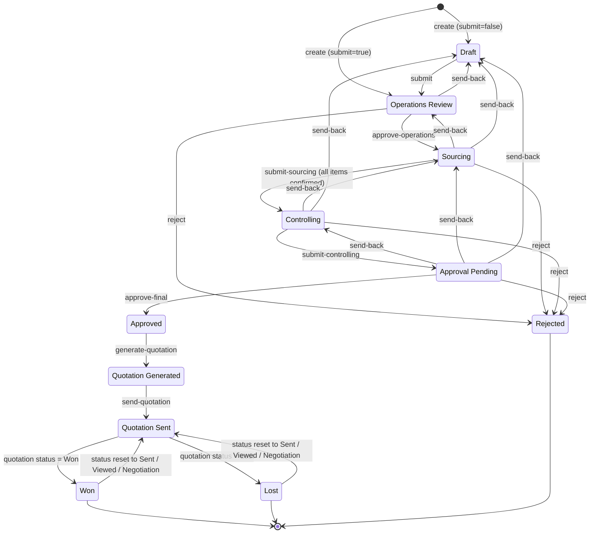

*Figure D6. RFQ stages and transitions. Labels are the API actions under `/api/rfq/rfqs/{id}/`.*

The diagram shows the eleven stages defined in `backend/rfq/models.py` (`STAGE_CHOICES`) and every transition the API performs. The forward path, send-back targets and rejectable stages come from `backend/rfq/workflow.py:38-55` and are checked on the server before each change [Verified]. The intended path ends at Won, Lost or Rejected. Two behaviours are not visible in the diagram. First, `generate-quotation`, `send-quotation` and the quotation status change do **not** check the current stage, so in practice they can be called from any stage (risk R1) [Verified: `backend/rfq/views.py:885-922`, `:260-301`]. Second, a Won or Lost RFQ can be re-opened to Quotation Sent by changing the quotation status back [Verified: `backend/rfq/views.py:289-295`].

#### 3.2.1 Stages, owners and exit conditions

| # | Stage | Owner (`STAGE_OWNER`) | Permission module (`STAGE_MODULE`) | Forward action and server-side check | Evidence |
|---|---|---|---|---|---|
| 1 | Draft | Sales | Create RFQ | `submit` — stage must be Draft; user needs edit on Create RFQ | `views.py:403` [Verified] |
| 2 | Operations Review | Operations | Operations Review | `approve-operations` — stage check + edit. The three checks are **not** validated on the server (the screen requires them) | `views.py:433`; `OperationsReviewScreen.tsx` [Verified] |
| 3 | Sourcing | Sourcing | Sourcing | `submit-sourcing` — stage check + edit + every item `sourcing_confirmed` | `views.py:751-761` [Verified] |
| 4 | Controlling | Controlling | Costing | `submit-controlling` — stage check + edit. Low-margin confirmation exists **only in the screen** | `views.py:805`; `ControllingScreen.tsx:139-147` [Verified] |
| 5 | Approval Pending | Approval Panel | Approval | `approve-final` — stage check + edit | `views.py:823` [Verified] |
| 6 | Approved | Sales | Create RFQ | `generate-quotation` — **no stage or permission check** | `views.py:885` [Verified] |
| 7 | Quotation Generated | Sales | Create RFQ | `send-quotation` — **no stage or permission check** | `views.py:911` [Verified] |
| 8 | Quotation Sent | Sales | Create RFQ | Quotation `status` → Won/Lost — **no role check**; audit role hard-coded "Sales" | `views.py:260-301` [Verified] |
| — | Won / Lost / Rejected | none | none (Admin only) | Terminal | `workflow.py:10-36` [Verified] |

#### 3.2.2 Send-back and reject rules

| From stage | May send back to | May reject | Evidence |
|---|---|---|---|
| Operations Review | Draft | Yes | `workflow.py:48-55` [Verified] |
| Sourcing | Operations Review, Draft | Yes | same |
| Controlling | Sourcing, Draft | Yes | same |
| Approval Pending | Controlling, Sourcing, Draft | Yes | same |
| Any other stage | — | No | same |

- The server checks the target and that the user may act on the **current** stage [Verified: `views.py:842-863`].
- The audit entry stores the authenticated user's real role, not a client-supplied one [Verified: `views.py:853-856`].
- A comment is mandatory in the screens (`SendBackModal.tsx`, `RejectModal.tsx`) but **not on the server**: an empty comment is accepted by the API [Verified: `views.py:846`, `:869`].
- A notification is created for the target stage's owner role (send back) or for Sales (reject) [Verified: `views.py:859`, `:878`].

#### 3.2.3 Pulley changes on a saved RFQ

Pulleys can be added, duplicated and removed in every stage from Draft to Approved, by whoever holds create/delete on the current stage's module; an RFQ always keeps at least one pulley [Verified: `views.py` `ITEM_EDITABLE_STAGES`, `_require_items_editable`, `remove_item`]. RFQ header details (customer, project, commercial terms, notes) are editable at any stage by users with edit on Create RFQ or on the current stage's module; every change is written to the RFQ's activity history [Verified: `views.py:478`].

### 3.3 Permission grid

The server keeps one grid per role: six **modules** × four **actions** (view, create, edit, delete) [Verified: `backend/accounts/role_permissions.py:13-14`]. Admin edits the grid on the Users & Roles page (`PATCH /api/auth/roles/<role>/`, Admin only). The grid is read from the database on every check, so a change applies from the next request [Verified: module docstring]. A role that was never edited uses these defaults [Verified: `role_permissions.py:39-49`]:

| Role | Create RFQ | Operations Review | Sourcing | Costing | Approval | Masters |
|---|---|---|---|---|---|---|
| Sales | V C E D | — | — | — | — | V |
| Operations | — | V C E D | — | — | — | V |
| Sourcing | — | — | V C E D | — | — | V |
| Controlling | — | — | — | V C E D | — | V |
| Approval Panel | — | — | — | V | V C E D | V |
| Admin | all (cannot be edited) | all | all | all | all | all |

*V = view, C = create, E = edit, D = delete.*

**Where the grid is applied on the server** [Verified]:

| Area | Rule | Evidence |
|---|---|---|
| Stage actions (submit, approve, sourcing, costing, send back, reject, items, attachments) | `edit` (or create/delete) on the stage's module | `workflow.py:67` `require_can_act` |
| Customers | write: Create RFQ or Masters; read: any signed-in user | `rfq/views.py:201` |
| Vendors | write: Sourcing, Costing or Masters | `rfq/views.py:208` |
| Products | write: Costing or Masters | `rfq/views.py:215` |
| Formulas, sheet fields, sections, Cost Rate Tables, catalogs, Raw Forging, In-House Hours | write: Masters or Costing (`MasterDataPermission`) | `accounts/permissions.py`; `reference/views.py`; `formulas/views.py` |
| Delivery Schedule | read: Sourcing or Masters; write (incl. reset/restore): Sourcing | `delivery/views.py` `CanEditDeliverySchedule` |
| Organization settings | write: Masters | `reference/views.py` `OrganizationSettingsView` |
| Per-RFQ field type overrides | Masters or Costing edit | `rfq/views.py` `validate_field_overrides` |
| Users, roles | Admin only | `accounts/views.py` `IsAdminRole` |
| RFQ create | any signed-in user (deliberately not gated) | `rfq/views.py:339-343` comment |
| Audit log, notifications, quotations | any signed-in user | `rfq/views.py:224-257` |

**Where the browser decides instead** [Verified]: menu visibility (`navConfig.ts` `roles: [...]`), "can act on this stage" (`src/lib/workflow.ts:105`, `role === 'Admin' || STAGE_OWNER[stage] === role`), field-type override buttons (`role === 'Controlling' || 'Admin'` in `RFQCreatePage.tsx` and `RfqItemsPanel.tsx`), In-House Hours rate editing and Delivery Schedule editing. The per-user grid returned by `GET /api/auth/me/` (`permissions`) is not read by the frontend (`src/store/authStore.ts` `MeResponse.permissions?: unknown`). Under the default grid the two agree; after an edit they can diverge (risk R4).

### 3.4 Notifications and tasks

- **Notifications** are database rows targeted at a role, created on submit, approvals, send back, reject and quotation events [Verified: `rfq/views.py` `append_notification`]. If "Send email notifications" is on in Settings, the same message is emailed to every active user of that role [Verified: `rfq/email.py` `notify_role_by_email`]. Read status is shared: one user marking a notification read marks it read for everyone, and "mark all read" marks every notification [Verified: `rfq/views.py` `NotificationViewSet`].
- **Tasks** are not stored. "My Tasks" lists the RFQs whose current stage the user's role owns, calculated in the browser [Verified: `src/lib/tasks.ts`].

### 3.5 Traceability to `REQUIREMENTS_DOCUMENT.md`

Status values: **Implemented** · **Partial** (part done or done only in the browser) · **Differs** (built differently) · **Not implemented**.

| Req. § | Requirement (short) | Status | Evidence / gap |
|---|---|---|---|
| 3 | Role-scoped navigation and data | Partial | Menus hidden per role (`navConfig.ts`); API reads of RFQs, quotations and audit log are open to all signed-in users (`rfq/views.py:224-327`) |
| 4.1 | Login, one role per session, switch role from header | Differs | Real login with role check; only Admin can "view as" (`authStore.ts:111`) |
| 4.2 | Role dashboards, one-click action, guided tour | Implemented | `src/features/dashboard/*.tsx`; tour `src/lib/tour.ts`, started from `Header.tsx:35` and `DashboardPage.tsx:36` |
| 4.3 | RFQ list, create, detail tabs, linear stages | Implemented | `RFQListPage.tsx`, `RFQCreatePage.tsx`, `RFQDetailPage.tsx` (9 tabs); `workflow.py` |
| 4.4 | Technical Data Sheet, catalog prices, live auto-calculation, in-house hours | Implemented | `PulleyTechDataForm.tsx`, `pulleyTechDataCalc.ts`; in-house minutes on the In-House Hours page (`InHouseHoursGrid.tsx`) |
| 4.5 | Operations: three checks, approve / send back / reject with mandatory comment | Partial | Checks and comment required only in the browser (`OperationsReviewScreen.tsx`); server does not validate them |
| 4.6 | Sourcing per component and process, vendor tag, confirm per item, gate to Controlling | Implemented | `SourcingScreen.tsx`; server gate `views.py:760` |
| 4.7 | Controlling: base cost from sourcing, adjustments, margin vs target, confirm below target | Partial | Implemented in the screen; below-target confirmation not enforced on server; target margin fixed at 15% on create (`views.py` `target_margin_percent=15`) |
| 4.8 | Approval: approve / send back / reject; comment mandatory on negative decisions | Partial | Comment mandatory only in the browser |
| 4.9 | Quotation generation, preview, sent, Won/Lost with reason | Partial | Implemented; Lost reason required only in the browser; no stage/role checks on server (R1); on-screen preview uses a fixed company name, the PDF uses Settings (`QuotationPreview.tsx` vs `rfq/pdf.py`) |
| 4.10 | Reference costing engine, editable reference data, every change attributable | Partial | All tables editable with `updated_by`/`updated_at` (last change only); full history only for formula expressions (`FormulaVersion`) and the Delivery Schedule (`DeliveryScheduleVersion`) |
| 4.11 | Dynamic per-RFQ delivery schedule from confirmed sourcing, size bands, at-risk flag, carried to quotation | Not implemented | Delivery Schedule is one company-wide sheet, "Standalone — not tied to any RFQ" (`delivery/models.py:24`; `DeliverySchedulePage.tsx:374`) |
| 4.12 | Customers, vendors, products master data | Implemented | `CustomersPage.tsx`, `VendorsPage.tsx`, `ProductsPage.tsx`; products are now editable (Costing/Masters), unlike the walkthrough's "view-only" |
| 4.13 | Personal task list; notifications per stage change | Partial | Tasks derived in the browser per role, not per user; notifications per role with shared read state |
| 4.14 | Reports and analytics | Implemented | `ReportsPage.tsx`, `AnalyticsPage.tsx`, calculated in the browser from loaded data |
| 4.15 | Immutable audit trail; per-RFQ and system-wide views | Partial | `AuditEvent` has no API to edit, but it is registered in Django admin with default (editable) settings (`rfq/admin.py:51`); readable by all signed-in users via API |
| 4.16 | Admin: users and roles; settings; reset to clean baseline | Partial | Users, roles and settings implemented; "Reset Demo Data" only re-fetches data from the server (`dataStore.ts:224`) — it does not reset anything |
| 6 | Traceability of every figure; live recalculation | Partial | Pricing recalculates live in the browser; saved Controlling base cost is a snapshot and changes only on "Recalculate" (`ControllingScreen.tsx`) |

### 3.6 Existing documents and how far they match the code

| Document | Status against the code | Label |
|---|---|---|
| `REQUIREMENTS_DOCUMENT.md` | Source of requirements; traced in 3.5 | [Verified] |
| `DEPLOYMENT_RUNBOOK.md` | Production procedure; describes the API as "formulas + reference data only" — out of date (full comparison in Part B, Section 5) | [Verified text; production state To confirm] |
| `WORKFLOW_WALKTHROUGH.md`, `PROTOTYPE_GUIDE.md` | Describe the earlier browser-only prototype ("everything is mock data in your browser's local storage", "Demo Role Login", role switcher for everyone, Vercel URL) | [Verified] — out of date |
| `CLIENT_CLARIFICATION_QUESTIONNAIRE.md` | Six open questions on rates, outsourced costs, in-house options and delivery | [Verified] |
| `README.md` (root) | Vite template text only | [Verified] |
| `backend/README.md` | Local setup and an API list covering formulas and reference data only | [Verified] — incomplete |

#### Figure D1 — System context

Source: [`docs/diagrams/D1_system_context.mmd`](diagrams/D1_system_context.mmd)

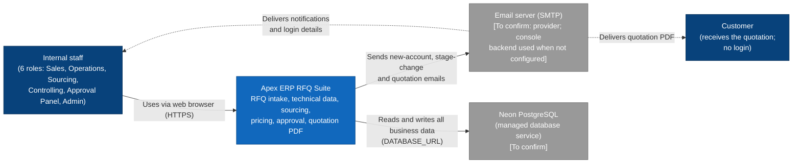

*Figure D1. System context (C4 level 1). Blue = people and the system; grey = external services.*

Staff in six roles use the suite through a browser over HTTPS [Verified: `curl -I`; roles in `accounts/models.py`]. The suite has two external dependencies. The first is an email server: when the `EMAIL_HOST_USER` setting is present Django sends real email over SMTP, otherwise it writes emails to the server log [Verified: `config/settings.py`, `EMAIL_BACKEND`]; whether production has SMTP configured, and with which provider, is [To confirm]. The second is the database: the runbook names an external Neon PostgreSQL instance reached through `DATABASE_URL` [To confirm]. Customers have no account; they only receive the quotation PDF by email, sent from the quotation page [Verified: `rfq/email.py` `send_quotation_email`]. No other external service (payment, single sign-on, file storage service, monitoring) was found in the code [Verified: `requirements.txt`, `package.json`, `settings.py`].

---

### Part A — To-confirm items

| # | Item | Question | Who can answer |
|---|---|---|---|
| TC-A1 | Client name | What client name should appear in place of **[Client name]**? | Project manager |
| TC-A2 | Authors, reviewers, approver | Who are the named authors, reviewers and approver for Section 0? | Project manager |
| TC-A3 | Classification | What confidentiality classification applies to this document? | Client IT / project manager |
| TC-A4 | Deployed version (A1) | Is commit `b6b8664` the code running in production? If not, which commit? | Server administrator |
| TC-A5 | Production settings (A2) | Is production running with `DEBUG=false` and a PostgreSQL `DATABASE_URL`? | Server administrator |
| TC-A6 | Hostinger plan and OS | Which Hostinger VPS plan and which Ubuntu version run the site? (The header shows `nginx/1.24.0 (Ubuntu)`, which suggests the Nginx package of Ubuntu 24.04 [Inferred].) | Server administrator / Hostinger account owner |
| TC-A7 | Database | Is production on Neon PostgreSQL? Which region and plan? | Server administrator |
| TC-A8 | Email | Is SMTP configured in production, and with which provider? Are emails actually delivered? | Server administrator |
| TC-A9 | Backups | Are database and `media/` (RFQ attachments) backups taken? How often, where, and has a restore been tested? | Server administrator |
| TC-A10 | Deployment method | Is production updated by hand with `git pull` from `main`, as the runbook says? | Developer / server administrator |
| TC-A11 | Requirement 4.1 | Should every user be able to switch roles (as written), or only Admin (as built)? | Client management |
| TC-A12 | Requirement 4.11 | Is the per-RFQ delivery schedule still required for the current release? | Client management |
| TC-A13 | Target margin | Is a fixed 15% target margin for every RFQ correct (`rfq/views.py` create)? | Client management (Controlling) |

---

# Part B — Architecture, detailed design, data design

## 4. Architecture

> **TL;DR**
> - A React single-page app talks to a Django REST API over HTTPS with a token header; Nginx serves the app and forwards `/api/` and `/admin/` to Django.
> - The server stores data and enforces the workflow; **all pricing arithmetic runs in the browser**, and the server stores the results it is sent.
> - Five Django apps make up the backend; the only external services are the database (Neon, [To confirm]) and an email server.

### 4.1 Architectural style

| Characteristic | What the code does | Label |
|---|---|---|
| Client | Single-page app (React 19, React Router 7, Zustand 5), built by Vite into static files in `dist/` | [Verified: `package.json`, `vite.config.ts`] |
| Server | One Django 6.1.1 project (`backend/config`) with five apps; JSON REST API via Django REST Framework 3.18.1 | [Verified: `backend/requirements.txt`, `settings.py`] |
| Authentication | DRF `TokenAuthentication` (header `Authorization: Token <key>`) and `SessionAuthentication`; default permission `IsAuthenticated` | [Verified: `settings.py` `REST_FRAMEWORK`] |
| Where calculation happens | Browser: `src/lib/pulleyTechDataCalc.ts`, `pulleyPricingCalc.ts`, `outsourcedCosts.ts`, `pricing.ts`. The server validates formulas but never prices an RFQ | [Verified] |
| Data loading | After login the browser loads every RFQ, quotation, customer, vendor, product, audit event and notification in one go; there is no paging | [Verified: `src/store/dataStore.ts` `loadAll`; no `DEFAULT_PAGINATION_CLASS` in `settings.py`] |
| API versioning | None (`/api/...` with no version prefix) | [Verified: `config/urls.py`] |
| Offline behaviour | If formula or reference data cannot be loaded, calculations fall back to constants hard-coded from the workbook | [Verified: `computeAutoFields`, `computePulleyPricing`] |
| Hosting | Nginx + Gunicorn on a VPS, port 8012 | [Verified: `DEPLOYMENT_RUNBOOK.md`; production To confirm] |

### 4.2 Containers

#### Figure D2 — Containers

Source: [`docs/diagrams/D2_containers.mmd`](diagrams/D2_containers.mmd)

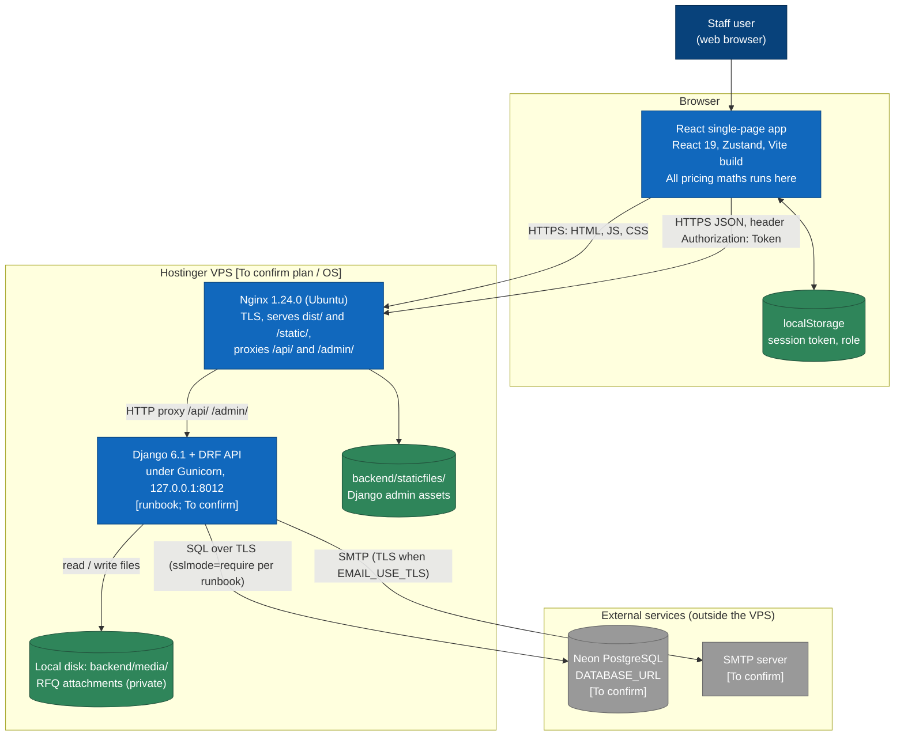

*Figure D2. Containers (C4 level 2). Blue = running software; green = data stores; grey = external services.*

The browser downloads the React app from Nginx and keeps the session token and selected role in `localStorage` under the key `rfq-prototype-auth` [Verified: `src/store/authStore.ts` `persist` name]. Every API call goes to Nginx, which forwards `/api/` and `/admin/` to Gunicorn on `127.0.0.1:8012`; Nginx also serves Django admin assets from `backend/staticfiles/` [Verified: runbook Nginx block; production To confirm]. Django reads and writes all business data in PostgreSQL through `DATABASE_URL` (runbook: Neon, `sslmode=require`) [To confirm]. Uploaded RFQ attachments are written to `backend/media/rfq_attachments/<rfq id>/` on the server's local disk and are only reachable through an authenticated API download — there is deliberately no `MEDIA_URL` and no Nginx location for them [Verified: `settings.py` `MEDIA_ROOT` comment; `rfq/models.py` `attachment_upload_path`]. Because attachments live on the VPS disk while the database lives at Neon, the two must be backed up separately [Inferred].

### 4.3 Backend components

#### Figure D3 — Backend components

Source: [`docs/diagrams/D3_backend_components.mmd`](diagrams/D3_backend_components.mmd)

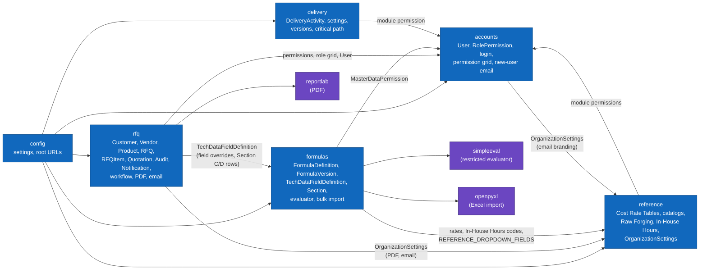

*Figure D3. Django apps (blue) and third-party libraries (purple); arrows are Python imports.*

`accounts` provides users, login and the permission grid that every other app imports. `formulas` owns the formula and Technical Data Sheet definitions and uses `simpleeval` for safe evaluation and `openpyxl` for Excel bulk import. `reference` owns rate tables, catalogs and company settings. `rfq` owns the business workflow and depends on the other three: on `accounts` for permissions, on `formulas` for field definitions (per-item field overrides and the Section C/D rows on the Sourcing screen), and on `reference` for company details in the PDF and email. `delivery` is independent apart from permissions. Two dependencies are circular at app level: `accounts` imports `reference` (email branding, `accounts/email.py`) while `reference` imports `accounts` (permissions), and `formulas/catalog_options.py` imports `reference/views.py` for its allow-list [Verified: imports]. These work today but make the apps harder to separate [Inferred].

### 4.4 Cross-cutting behaviour

| Concern | Behaviour | Evidence |
|---|---|---|
| Error format | DRF JSON errors, usually `{"detail": "..."}` or `{field: [messages]}`; the Delivery Schedule adds `{"errors": [...]}` | `delivery/views.py` `bad_request`; `src/lib/apiClient.ts` [Verified] |
| Session expiry | A 401 from any call signs the user out and redirects to `/login` | `apiClient.ts` `handleUnauthorized` [Verified] |
| Token lifetime | Tokens do not expire; the same token is reused on every login until logout deletes it | `accounts/views.py` `Token.objects.get_or_create`; no expiry setting [Verified] |
| CORS | All origins allowed when `DEBUG` is true; otherwise only `CORS_ALLOWED_ORIGINS` | `settings.py` [Verified] |
| Time | `USE_TZ=True`, `TIME_ZONE="UTC"`; RFQ, quotation, audit and notification timestamps are stored as ISO **text** (`CharField`), not date columns | `settings.py`; `rfq/models.py` [Verified] |

### 4.5 Technology stack

| Layer | Component | Version (pinned) | Source |
|---|---|---|---|
| Backend | Python | 3.14.3 locally; production [To confirm] | `python --version` |
| Backend | Django / DRF / django-cors-headers | 6.1.1 / 3.18.1 / 4.9.0 | `backend/requirements.txt` |
| Backend | simpleeval / reportlab / openpyxl | 1.0.8 / 5.0.1 / 3.1.5 | same |
| Backend | dj-database-url / psycopg2-binary / python-dotenv | 3.1.2 / 2.9.13 / 1.2.3 | same |
| Backend | Gunicorn | **not listed** in `requirements.txt` (runbook starts it from the venv) | `requirements.txt`; runbook Step 6 |
| Frontend | React / React DOM / React Router | ^19.2.8 / ^19.2.8 / ^7.18.2 | `package.json` |
| Frontend | Zustand / Recharts / date-fns / driver.js / lucide-react | ^5.0.15 / ^3.10.1 / ^4.4.0 / ^1.8.0 / ^1.35.0 | same |
| Build | Vite / TypeScript / Tailwind CSS / oxlint | ^8.2.2 / ~6.0.2 / ^4.3.3 / ^1.79.0 | same |
| Web server | Nginx | 1.24.0 (Ubuntu) | `curl -I` response header [Verified] |
| Database | PostgreSQL (Neon) in production; SQLite in development | — | runbook [To confirm]; `settings.py` default [Verified] |

---

## 5. Detailed design

> **TL;DR**
> - The API has 100 routes across five apps; every route needs login except `POST /api/auth/login/`, but **eight** RFQ/quotation/notification actions have no role or stage check beyond login.
> - Formulas are validated on the server with `simpleeval` and evaluated in the browser by a small purpose-built parser; the two accept **different** syntax.
> - Several business rules (mandatory comments, the three Operations checks, low-margin confirmation, Lost reason, cost-breakdown arithmetic) are enforced only in the browser.

### 5.1 Backend apps at a glance

| App | Purpose | Models | Python lines (excl. tests, migrations) | Evidence |
|---|---|---|---|---|
| `accounts` | Users, login, permission grid, new-user email | `User`, `RolePermission` | ≈ 480 | `backend/accounts/` |
| `formulas` | Formula registry, Technical Data Sheet fields, sections, evaluator, Excel bulk import | `Section`, `FormulaDefinition`, `TechDataFieldDefinition`, `FormulaVersion` | ≈ 2,240 | `backend/formulas/` |
| `reference` | Cost Rate Tables, catalogs, Raw Forging, In-House Hours, company settings | 15 models (Section 6.3) | ≈ 1,200 | `backend/reference/` |
| `rfq` | Customers, vendors, products, RFQs, items, cost breakdown, quotations, attachments, audit, notifications, workflow, PDF, email | 10 models | ≈ 2,480 | `backend/rfq/` |
| `delivery` | Delivery Schedule sheet, critical path, versions | `DeliveryActivity`, `DeliveryScheduleSettings`, `DeliveryScheduleVersion` | ≈ 730 | `backend/delivery/` |

Line counts are from `wc -l` on 2026-11-16 and rounded [Verified].

**How the endpoint tables below were produced.** The route list was generated by walking Django's URL resolver (`get_resolver()`) with a read-only script and reading each view's `permission_classes` [Verified: command output, 100 API routes: auth 7, formulas 13, reference 31, rfq 44, delivery-schedule 5]. Stage rules were read from each view method. Column meanings:

- **Permission** — the class or check applied. `Login only` means any signed-in user of any role.
- **Stage rule on server** — `Yes` = the view checks the RFQ's stage; `No` = it does not; `—` = not applicable.
- **⚠** marks an endpoint with no check beyond login that changes data, or a rule enforced only in the browser.
- `ModulePermission(A, B)` lets a user **write** with the needed action on module A *or* B; **reads are open to every signed-in user** unless stated (`accounts/permissions.py` `module_permission`, `read_modules=None`).

### 5.2 `accounts` — users, login, permission grid

| Method | Path | Permission | Purpose |
|---|---|---|---|
| POST | `/api/auth/login/` | Public (`AllowAny`) | `{username, password, role?}` → `{token, user + permissions}`; 401 wrong password; 403 role mismatch (`views.py:20-37`) |
| POST | `/api/auth/logout/` | Login only | Deletes the user's token |
| GET | `/api/auth/me/` | Login only | Current user and their permission grid |
| GET | `/api/auth/roles/` | `IsAdminRole` | Every role's grid |
| PUT/PATCH | `/api/auth/roles/{role}/` | `IsAdminRole` | Replace one role's grid; Admin's grid cannot be edited |
| GET, POST | `/api/auth/users/` | `IsAdminRole` | List; create (emails username, **password** and role to the new user — `accounts/email.py`) |
| GET, PUT, PATCH, DELETE | `/api/auth/users/{id}/` | `IsAdminRole` | Retrieve, update role/active/name/email, delete (not self) |

Key design points [Verified]: superusers are always saved as role `Admin` (`models.py:22`); the grid is read from the database on every check (no cache); `has_any_permission` returns true for any active Admin.

### 5.3 `formulas` — formula registry and sheet fields

| Method | Path | Permission | Purpose |
|---|---|---|---|
| GET, POST | `/api/formulas/` | `ModulePermission(Masters, Costing)` | List all formulas; create a standalone formula |
| GET, PUT, PATCH, DELETE | `/api/formulas/{key}/` | same | Read; edit **expression only** (writes a `FormulaVersion`); delete if nothing depends on it |
| GET | `/api/formulas/{key}/history/` | same | Version history |
| POST | `/api/formulas/{key}/preview/` | same | Evaluate current and candidate expression with sample variables, without saving |
| GET | `/api/formulas/variables/` | same | Every name an expression may use (fields, formulas, cost rates, In-House Hours, catalog prices) |
| POST | `/api/formulas/delete-all/` | `IsAdminRole` | Delete **every** formula (Auto fields revert to Manual) |
| GET, POST | `/api/formulas/tech-data-fields/` | `ModulePermission(Masters, Costing)` | List sheet fields with live catalog options and prices; create Manual or Auto field |
| GET, PUT, PATCH, DELETE | `/api/formulas/tech-data-fields/{key}/` | same; core-field type change and delete need Admin | Edit key (renames references), label, section, type, options, fixed value, Manual↔Auto |
| GET | `/api/formulas/tech-data-fields/dropdown-options/` | same | Catalog-linked selects with options and prices |
| GET, POST | `/api/formulas/sections/` | same | Section registry (label, order, tab) |
| GET, PUT, PATCH, DELETE | `/api/formulas/sections/{id}/` | same | Rename cascades to every field and formula using the old label; delete blocked while in use |
| POST | `/api/formulas/bulk-import/` | same | Excel `.xlsx` ≤ 2 MB, ≤ 1,000 rows per sheet; `dry_run` defaults to true; all-or-nothing transaction |
| GET | `/api/formulas/bulk-import/template/` | Login only | Download the blank workbook |

Management commands [Verified: `formulas/management/commands/`]: `seed_formulas` (48 formulas: 7 sheet auto fields + Sections A–F), `backfill_tech_data_fields` (the 49 core sheet fields), `rebuild_input_variables` (repair). The formula engine is described in 5.9.

### 5.4 `reference` — rates, catalogs, settings

All routes below use `ModulePermission(Masters, Costing)`: **write** = Controlling or Admin under the default grid; **read** = any signed-in user [Verified: `reference/views.py` `BaseReferenceViewSet`]. Each `{name}/` route supports GET (list) and POST (create); each `{name}/{id}/` route supports GET, PUT, PATCH and DELETE.

| Path under `/api/reference/` | Model | Page |
|---|---|---|
| `cost-rates/global-parameters/` | `GlobalParameter` | Cost Rate Tables (A) |
| `cost-rates/material-rates/` | `MaterialRate` | Cost Rate Tables (B) |
| `cost-rates/machining-labour-rates/` | `MachiningLabourRate` | Cost Rate Tables (C) |
| `cost-rates/logistics-packing-rates/` | `LogisticsPackingRate` | Cost Rate Tables (E) |
| `cost-rates/lagging-rates/` | `LaggingCatalogEntry` | Cost Rate Tables (lagging) |
| `raw-forging/shaft-bands/`, `raw-forging/shell-bands/` | `ShaftForgingBand`, `ShellForgingBand` | Raw Forging Prices |
| `catalogs/bearings/`, `catalogs/sleeves/`, `catalogs/housings/` | `BearingCatalogEntry`, `SleeveCatalogEntry`, `HousingCatalogEntry` | Bearing & Sleeve Data |
| `catalogs/lag-data/`, `catalogs/lcd-data/` | `LagDataEntry`, `LcdDataEntry` | Bearing & Sleeve Data |
| `catalogs/locking-devices/` | `LockingDeviceCatalogEntry` | (no page uses it; the frontend reads `lcd-data`) [Verified: `referenceStore.ts`] |
| `in-house-hours/` | `InHouseHourRate` | In-House Hours |

| Method | Path | Permission | Purpose |
|---|---|---|---|
| GET | `/api/reference/catalogs/dropdown-fields/` | `ModulePermission(Masters, Costing)` | Allow-listed tables and columns for catalog pickers |
| GET | `/api/reference/catalogs/dropdown-values/?table=&label_field=&value_field=` | same | Values of one allow-listed column; parameters are only used as keys into a fixed map, never as model or field names |
| GET, PUT, PATCH | `/api/reference/organization-settings/` | `ModulePermission(Masters)` | Singleton company settings (profile, currency, tax label, SLA days, notification switches, quotation header/footer, terms) |

### 5.5 `rfq` — workflow, quotations, audit, notifications

#### 5.5.1 Master data

| Method | Path | Permission (write) | Read |
|---|---|---|---|
| GET, POST · GET, PUT, PATCH, DELETE | `/api/rfq/customers/` · `/{id}/` | `ModulePermission(Create RFQ, Masters)` | Any signed-in user |
| same | `/api/rfq/vendors/` · `/{id}/` | `ModulePermission(Sourcing, Costing, Masters)` | Any signed-in user |
| same | `/api/rfq/products/` · `/{id}/` (delete blocked if used by an item) | `ModulePermission(Costing, Masters)` | Any signed-in user |

#### 5.5.2 RFQ actions — `/api/rfq/rfqs/...`

`RFQViewSet` itself only requires login; each action adds its own checks from `rfq/workflow.py` [Verified: `rfq/views.py`, `rfq/sourcing_costs.py`].

| Method | Path (after `/api/rfq/rfqs/`) | Permission check in the view | Stage rule on server | Notes / browser-only rules |
|---|---|---|---|---|
| GET | `` (list), `{id}/` | Login only | — | Returns every RFQ to every role |
| POST | `` (create) | Login only (deliberate, `views.py:339-343`) | Sets Draft or Operations Review | Quantity > 0 and prices ≥ 0 checked; field overrides need Masters/Costing edit |
| POST | `{id}/submit/` | edit on Create RFQ | Yes (Draft) | — |
| PATCH | `{id}/operations-review/` | edit on Operations Review | Yes | Stores the review JSON as sent |
| POST | `{id}/approve-operations/` | edit on Operations Review | Yes | ⚠ The three checks are required **only in the browser** |
| PATCH | `{id}/details/` | edit on Create RFQ **or** current stage's module | No (any stage) | Validates project name, priority, email; logs each change |
| PATCH | `{id}/item-tech-data/` | edit on current stage's module | No (any stage whose module the user holds) | Stores the browser-computed sheet as sent; override changes need Masters/Costing edit |
| POST | `{id}/items/` | create on current stage's module | Yes (Draft … Approved) | Next item number and pulley tag |
| POST | `{id}/items/{item_id}/duplicate/` | create on current stage's module | Yes (Draft … Approved) | Copies sheet, overrides and sourcing data; not confirmation or cost breakdown |
| DELETE | `{id}/items/{item_id}/` | delete on current stage's module | Yes (Draft … Approved) | Keeps at least one item; renumbers |
| POST | `{id}/attachments/` | create on current stage's module | No | Extension allow-list, 15 MB, max 20 per RFQ |
| DELETE | `{id}/attachments/{attachment_id}/` | delete on current stage's module | No | Deletes file and row |
| GET | `{id}/attachments/{attachment_id}/download/` | Login only | — | Any signed-in user can download any RFQ's attachments |
| PATCH | `{id}/item-sourcing-confirmed/` | edit on Sourcing | Yes (Sourcing) | — |
| PATCH | `{id}/item-process-vendor/` | edit on Sourcing | Yes | Vendor id/name stored as sent (not checked against the vendor table) |
| PATCH | `{id}/item-process-cost/` | edit on Sourcing | Yes | Cost ≥ 0; only when the process is "Outsource" |
| PATCH | `{id}/item-outsourced-field-cost/` · `-mode/` · `-meta/` | edit on Sourcing | Yes | Field must be a non-total Pricing Section C/D field |
| POST, PATCH, DELETE | `{id}/item-custom-process/` | edit on Sourcing | Yes | Custom rows; cost = MHR rate × (run + setup minutes) when minutes are sent |
| PATCH | `{id}/sourcing-comment/` | edit on Sourcing | Yes | — |
| POST | `{id}/submit-sourcing/` | edit on Sourcing | Yes + every item confirmed | — |
| POST | `{id}/cost-breakdown/` | edit on Costing | Yes (Controlling) | ⚠ Inputs checked ≥ 0, but adjusted cost, margin, selling and final price are **stored as calculated by the browser**; `rfq.value` = Σ final price |
| POST | `{id}/submit-controlling/` | edit on Costing | Yes | ⚠ Low-margin confirmation **only in the browser** |
| POST | `{id}/approve-final/` | edit on Approval | Yes | Comment optional |
| POST | `{id}/send-back/` | edit on current stage's module | Yes (target must be valid) | ⚠ Comment mandatory **only in the browser** |
| POST | `{id}/reject/` | edit on current stage's module | Yes (rejectable stages) | ⚠ Reason and comment mandatory **only in the browser** |
| POST | `{id}/generate-quotation/` | ⚠ **Login only** | ⚠ **No** | Any role, any stage, repeatable (creates a new quotation each time) |
| POST | `{id}/send-quotation/` | ⚠ **Login only** | ⚠ **No** | Sets RFQ to Quotation Sent and every quotation of the RFQ to Sent |

#### 5.5.3 Quotations, audit log, notifications

| Method | Path | Permission | Stage rule | Notes |
|---|---|---|---|---|
| GET | `/api/rfq/quotations/`, `/{id}/` | Login only | — | Every quotation to every role |
| GET | `/api/rfq/quotations/{id}/pdf/` | Login only | — | PDF built on request (5.12) |
| POST | `/api/rfq/quotations/{id}/send-email/` | ⚠ Login only | No | Emails the PDF to the customer |
| PATCH | `/api/rfq/quotations/{id}/status/` | ⚠ Login only | No | ⚠ Any status text is saved (no choice validation); Won/Lost moves the RFQ; Lost reason optional on server; audit role hard-coded "Sales" |
| GET | `/api/rfq/audit-log/?rfqId=` | Login only | — | Whole audit trail readable by every role; the page is Admin-only in the menu |
| GET | `/api/rfq/notifications/` | Login only | — | All notifications (frontend filters by role) |
| PATCH | `/api/rfq/notifications/{id}/read/` | ⚠ Login only | — | Marks it read for everyone |
| POST | `/api/rfq/notifications/mark-all-read/` | ⚠ Login only | — | Marks **every** notification read for everyone |

### 5.6 `delivery` — Delivery Schedule

| Method | Path | Permission | Purpose |
|---|---|---|---|
| GET | `/api/delivery-schedule/` | read: view on Sourcing **or** Masters (every role by default) | Rows with days, earliest/latest start and finish, float, critical flag, totals |
| PUT, PATCH | `/api/delivery-schedule/` | edit on Sourcing | Save the whole sheet; validates codes, links, cycles; records a version |
| POST | `/api/delivery-schedule/reset/` | edit on Sourcing | Restore the workbook rows (29 activities, 1.2 safety factor) and record a version |
| GET | `/api/delivery-schedule/versions/`, `/versions/{id}/` | read as above | Version list; one version recalculated |
| POST | `/api/delivery-schedule/versions/{id}/restore/` | edit on Sourcing | Load a version into the live sheet; recorded as a new version |

Calculation [Verified: `delivery/calc.py`]: an activity's days = override days if Outsourced and an override is set, else standard days; "—" rows count 0. Total calendar days = the critical path through the "Depends on" links (forward pass for earliest start/finish, backward pass for latest, float = latest start − earliest start; zero float and days > 0 = critical). Delivery weeks = total ÷ 7 × safety factor. The browser repeats the same maths in `src/lib/deliveryCpm.ts` for live editing. The sheet is company-wide and is **not linked to RFQs** (requirement 4.11, Section 3.5). The browser's Edit button follows `role === 'Admin' || role === 'Sourcing'` (`DeliverySchedulePage.tsx:236`), not the grid.

### 5.7 Summary of endpoint flags

**Endpoints that change data with no check beyond login** (input to Part C):

| # | Endpoint | Effect | Evidence |
|---|---|---|---|
| E1 | `POST /api/rfq/rfqs/{id}/generate-quotation/` | Creates a quotation and moves the RFQ to Quotation Generated from any stage | `rfq/views.py:885` |
| E2 | `POST /api/rfq/rfqs/{id}/send-quotation/` | Moves the RFQ to Quotation Sent from any stage | `rfq/views.py:911` |
| E3 | `PATCH /api/rfq/quotations/{id}/status/` | Sets Won/Lost (and the RFQ stage) and any status text | `rfq/views.py:260` |
| E4 | `POST /api/rfq/quotations/{id}/send-email/` | Sends an email with the PDF to the customer | `rfq/views.py:311` |
| E5 | `PATCH /api/rfq/notifications/{id}/read/`, `POST .../mark-all-read/` | Changes shared read state for all users | `rfq/views.py:242-252` |
| E6 | `POST /api/rfq/rfqs/` | Creates RFQs (deliberately open to every role) | `rfq/views.py:339-343` |

**Reads open to every signed-in user** that the menus restrict: audit log, all RFQs and quotations, attachment downloads, Cost Rate Tables, formulas, catalogs, organization settings [Verified].

**Rules enforced only in the browser:**

| # | Rule | Browser | Server |
|---|---|---|---|
| B1 | Comment required on send back and reject; reason required on reject | `SendBackModal.tsx`, `RejectModal.tsx` | Accepts empty values (`views.py:846`, `:868-869`) |
| B2 | All three Operations checks completed before approval | `OperationsReviewScreen.tsx` `canApprove` | Not checked |
| B3 | Confirm before submitting below target margin | `ControllingScreen.tsx` `confirmLowMargin` | Not checked |
| B4 | Cost-breakdown arithmetic (adjusted cost, margin, selling, tax, final) | `src/lib/pricing.ts` | Stored as sent |
| B5 | Lost requires a loss reason | `QuotationDetailPage.tsx` | Optional |
| B6 | Which role sees which page and button | `navConfig.ts`, `workflow.ts:105`, role checks in pages; `App.tsx` routes check login only, not role | API checks (mostly) |
| B7 | Low-margin warning and target margin colouring | `src/lib/pricing.ts` `marginStatus` | — |

### 5.8 `DEPLOYMENT_RUNBOOK.md` compared with the code

The runbook states: *"Django REST API (formulas + reference data only, per the build plan) on port 8012 via Gunicorn"* and verifies the deployment with `curl -I https://pricing.nxsys.in/api/formulas/`. The real API is much larger.

#### 5.8.1 API scope

| Area | Runbook says | Code has (route count from URL resolver) | Difference |
|---|---|---|---|
| Formulas | In scope | 13 routes under `/api/formulas/` incl. sheet fields, sections, variables, preview, history, bulk import, delete-all | Sheet fields, sections, bulk import and delete-all not mentioned |
| Reference data | In scope | 31 routes under `/api/reference/` incl. In-House Hours, lag/LCD data, dropdown lookups, organization settings | In-House Hours, organization settings and dropdown lookups not mentioned |
| Authentication and users | Not mentioned | 7 routes under `/api/auth/` (login, logout, me, roles, users) | **Missing** |
| RFQ workflow, master data, quotations, audit, notifications | Not mentioned ("formulas + reference data only") | 44 routes under `/api/rfq/` | **Missing** — the main business function |
| Delivery Schedule | Not mentioned | 5 routes under `/api/delivery-schedule/` | **Missing** |
| File uploads | Not mentioned | RFQ attachments up to 15 MB; Excel bulk import up to 2 MB | **Missing** (see 5.8.2) |
| Outbound email | Not mentioned | New-user, notification and quotation emails | **Missing** |

#### 5.8.2 Other differences between the runbook and the code

| # | Topic | Runbook | Code / config | Label |
|---|---|---|---|---|
| RB1 | Gunicorn | Systemd unit runs `venv/bin/gunicorn` after `pip install -r requirements.txt` | `gunicorn` is **not** in `backend/requirements.txt`, so a fresh install following the runbook has no Gunicorn | [Verified]; how production got it [To confirm] |
| RB2 | Upload size | Nginx block has no `client_max_body_size` | Attachments allowed up to 15 MB (`rfq/models.py` `MAX_ATTACHMENT_SIZE_BYTES`). Nginx's documented default limit is 1 MB, so larger uploads would be refused by Nginx with HTTP 413 | [Verified config text]; effect [Inferred]; production Nginx config [To confirm] |
| RB3 | Attachment storage | Not mentioned | Files written to `backend/media/` on the VPS; must survive deploys and be backed up | [Verified] |
| RB4 | Seed data | Runs `seed_reference_data` and `seed_formulas` | `backfill_tech_data_fields` (core sheet fields) is not in the runbook; the Delivery Schedule is seeded by migration `delivery/0002`; `seed_demo_rfqs` exists for demo data | [Verified] |
| RB5 | Seeding needs the frontend source | Not mentioned | `seed_reference_data` reads `src/data/pulleyCatalogs.ts` from the repository (`FRONTEND_SRC`), so the backend must be deployed together with `src/` | [Verified: `reference/management/commands/seed_reference_data.py:34`] |
| RB6 | Environment settings | `SECRET_KEY`, `DEBUG`, `ALLOWED_HOSTS`, `CORS_ALLOWED_ORIGINS`, `DATABASE_URL` | Also read: `EMAIL_HOST`, `EMAIL_PORT`, `EMAIL_HOST_USER`, `EMAIL_HOST_PASSWORD`, `EMAIL_USE_TLS`, `DEFAULT_FROM_EMAIL` | [Verified: `settings.py`] |
| RB7 | Sign-in link in emails | Not mentioned | `accounts/email.py` reads `settings.FRONTEND_URL`, but `settings.py` never sets it, so new-user emails never contain a sign-in link | [Verified] |
| RB8 | Health check | `curl -I .../api/formulas/` | Every `/api/` route except login requires a token; an unauthenticated `curl` returns 401 (DRF default with `TokenAuthentication`). A 401 still shows Django is running | [Inferred] |
| RB9 | Database | Neon PostgreSQL, `sslmode=require` | Any `DATABASE_URL` accepted; `conn_max_age=600`; SQLite if unset | [Verified]; production [To confirm] |
| RB10 | Source of the "same pattern" | Refers to `vps_server_setup.md` "Application 4" | File not in this repository | [To confirm] |

### 5.9 Formula engine

#### 5.9.1 Two evaluators

| | Server — `backend/formulas/evaluator.py` | Browser — `src/lib/formulaEval.ts` |
|---|---|---|
| Used for | Validating expressions on save; `/preview/` | Every live calculation (sheet, Pricing Tool, Sourcing, Controlling) |
| Engine | `simpleeval` 1.0.8, class `EvalWithCompoundTypes`, with `iff` short-circuit added | Purpose-built tokenizer and recursive-descent parser (no `eval`, no third-party parser) |
| Functions | `min`, `max`, `round`, `abs`, `sqrt`, `pow` (simpleeval's bounded `safe_power`), `iff` | Same seven |
| Constants | `PI` | `PI` |
| Unknown variable | Read as 0 (retries up to 25 missing names) | Read as 0 |
| Result | Must be a number | Must be a number (NaN rejected) |

**The two do not accept the same syntax** [Verified by running the server evaluator on 2026-11-16 and reading the browser tokenizer]:

| Expression | Server result | Browser |
|---|---|---|
| `2**3` | 8 | Error (`*` then `*` → unexpected token) |
| `5%2` | 1 | Error (unexpected character `%`) |
| `7//2` | 3 | Error |
| `1 if 1 else 2` | 1 | Error |
| `1 and 0`, `not 0` | 0, 1 | `and`/`not` read as unknown variables (0) or parse error |
| `[x for x in [1,2]][0]` | 1 | Error |
| `1e3` | 1000 | Error (`e3` read as a separate identifier) |
| `pow(2,3)`, `iff(0, 1/0, 5)` | 8, 5 | 8, 5 |

Consequence [Inferred]: an expression using `**`, `%`, `//`, ternary or `and`/`or`/`not` passes server validation, is saved, then fails in the browser, which logs a console warning and silently switches the **whole** calculation to the hard-coded fallback (`computeAutoFields` / `computePulleyPricing` `catch`). The module docstring says comprehensions are not allowed; `EvalWithCompoundTypes` does allow them.

#### 5.9.2 How unsafe input is blocked

| Control | Where | Label |
|---|---|---|
| No `eval`/`exec`; only an allow-listed syntax tree is evaluated (simpleeval) | `evaluator.py` | [Verified] |
| Attribute access rejected (`sectionA.a1` → "Attribute does not exist") | simpleeval behaviour, observed | [Verified: command output] |
| Only seven whitelisted functions; `len` and others rejected | `ALLOWED_FUNCTIONS` | [Verified: command output] |
| `pow` uses `safe_power` to stop huge exponents | `evaluator.py` comment | [Verified] |
| Browser parser has no property access, assignment or function values; unknown functions rejected | `formulaEval.ts` | [Verified] |
| Only Controlling and Admin (Masters/Costing write) can save formulas | `MasterDataPermission` | [Verified] |
| Size limits on comprehension or list results on the server | Not configured in this code; depends on simpleeval defaults | [To confirm — Part C] |

#### 5.9.3 Save-time validation (server)

When an Auto field or formula is saved [Verified: `formulas/views.py` `resolve_expression_variables`, `perform_update`]:
1. Extract every identifier except functions and `PI`.
2. Reject names that are not a known key: sheet field, formula, Cost Rate Tables key, `c#RateInrPerHour`, In-House Hours variables (`c#RunMin`, `c#SetupMin`, `c#TotalMin`, `c#InHouseCost`), or catalog price variable (`bearing1Price` …).
3. Reject self-reference.
4. Reject a text select used in arithmetic (unless it is catalog-linked to a price column).
5. Text and Select Auto fields may only *copy* one field (expression is a single key).
6. Dry-run with every variable = 1.
7. Save the expression, store the **derived** `input_variables` (never the client's list), and write a `FormulaVersion` row.

Renaming a field key rewrites every expression that used it and logs a version for each [Verified: `_rename_references`].

#### 5.9.4 Run-time evaluation (browser)

#### Figure D8 — Formula evaluation

Source: [`docs/diagrams/D8_formula_evaluation.mmd`](diagrams/D8_formula_evaluation.mmd)

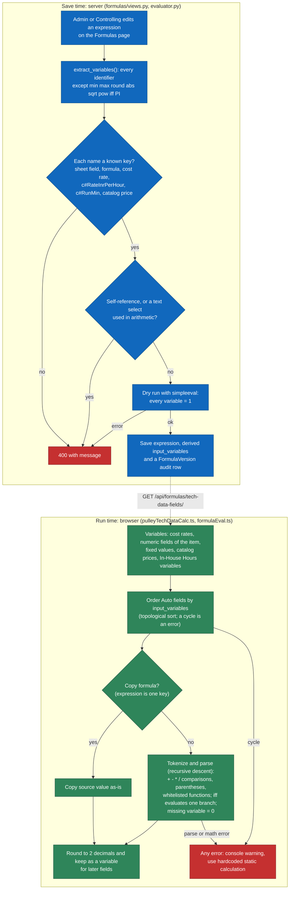

*Figure D8. Save-time validation on the server (blue) and run-time evaluation in the browser (green); red = failure paths.*

On save, the server makes sure every name in an expression exists and that it runs with dummy values. In the browser, `computeAutoFieldsDynamic` builds a variable bag in this precedence order — Cost Rate Tables keys, then the item's own numeric values (with Formulas-page fixed values filling empty fields and catalog-linked selects read as their row price), then In-House Hours variables — and evaluates every Auto field in dependency order using a topological sort over `input_variables` [Verified: `pulleyTechDataCalc.ts`]. A copy formula copies the source value without arithmetic and, for a bearing/sleeve/housing designation, re-looks-up the paired price. Results are rounded to two decimals. Any error (cycle, parse error, division by zero outside `iff`) is caught, logged to the browser console, and the hard-coded static calculation is used instead — the user is not told [Verified: `computeAutoFields` `catch`].

#### 5.9.5 Pricing Tool Sections A to F

The page shows, for each section, either the Formulas-page fields filed under "Pricing Section A … F" (when any exist) or the built-in lines below [Verified: `PricingToolPage.tsx` `formulaSections`]. The seeded built-in expressions are [Verified: `seed_formulas.py`]; the live database may differ because they are editable (the development database has 100 formulas against 48 seeded) [Verified: DB query].

| Section | Lines (seeded expression, simplified) |
|---|---|
| A — Raw materials | A1 shell = `shellRatePerKg × shellPlateWeight` · A2 end disc = `endDiscRatePerKg × hubMass` · A3 hub = 0 (open) · A4 shaft = `shaftMaterialRateInrPerKg × shaftMass` · A5 weld = `weldConsumablesInrPerKgPulley × shellPlateWeight` · A6 grease = `greaseInrPerKgPulley × hubMass` |
| B — Ancillary parts | B1 `bearing1Price + bearing2Price` · B2 `2 × sleevePrice` · B3 `2 × housingPrice` · B4 `2 × lockingDevicePrice` · B5 = 0 (open) · B6 `deadShaftParts` |
| C — In-house processing | One line per operation c1 … cN: `c#InHouseCost` = MHR rate × (run + setup minutes) from the In-House Hours page (see note) |
| D — Outsourced processing | D2 stress relief, D4 painting, D5 lagging, D6 balancing, D7 rolling — each `iff(<process is Outsource>, rate × quantity, 0)`; D1, D3, D8 = 0 (open) |
| E — Packing and shipment | E1 crate per 100 kg · E2–E3 inbound freight per kg · E4 per order · E5 outbound FOB per kg · E6 = 0 (open) |
| F — Summary | Total direct cost/unit = A+B+C+D+E · × qty · list = × markup · net = list × (1 − OEM discount) · incl. GST = net × (1 + GST) · EUR = net ÷ exchange rate · margin % = (list − cost) ÷ list × 100 · item total = net × qty |

Notes [Verified unless stated]:
- **Section C unit.** `c#InHouseCost = c#RateInrPerHour × (run + setup minutes)` (`pulleyTechDataCalc.ts` `inHouseHoursVars`). The rate column is labelled "MHR Rate (INR/h)" (`MhrLhrCalculatorPage.tsx`) while minutes are multiplied directly. The code comment says this mirrors the workbook cell `=$E7*H7`. Whether the workbook rate is per hour or per minute is [To confirm].
- **Item total counts quantity twice.** Total direct cost is already × qty, and item total = net price × qty again; the code keeps this "to match the source" (`pulleyPricingCalc.ts` comment).
- **Shaft rate.** `shaftMaterialRateInrPerKg` is always taken from hard-coded constants (310 or 330 INR/kg by material), in both the dynamic and the fallback path (`buildPricingVariables`); the Raw Forging Prices table does not feed it.
- **Sourcing adjustments.** `computeWithSourcing` (`outsourcedCosts.ts`) applies Sourcing's manual costs, moves a row to section C, D or E by its mode, zeroes hidden rows, and adds custom processes to the section totals, in two passes.
- **Controlling base cost** = the Formulas-page "Total Direct Cost" with Sourcing applied (`formulaCostSummary`), else the built-in total.

### 5.10 Reference data and how it reaches pricing

#### Figure D9 — Data flow into pricing

Source: [`docs/diagrams/D9_data_flow.mmd`](diagrams/D9_data_flow.mmd)

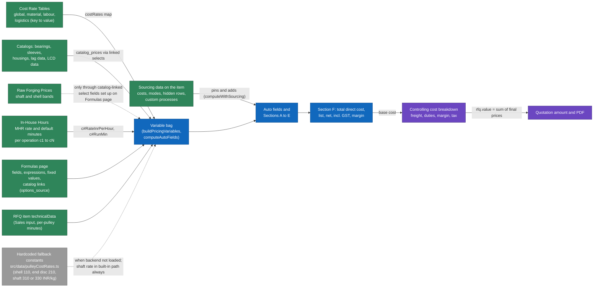

*Figure D9. Reference data (green) entering the pricing calculation (blue) and its outputs (purple); grey = hard-coded fallback.*

Cost Rate Tables rows are merged into one key → value map (`formulaStore.buildCostRates`) and every key is a formula variable; keys must be unique across the four tables and cannot be renamed [Verified: `reference/serializers.py` `CostRateTableSerializer`]. Catalog rows reach pricing through Technical Data Sheet selects linked to a catalog by `options_source` (`table::label_field::value_field::picked_label`); the server returns each option's price live, so new catalog rows appear without re-linking [Verified: `formulas/catalog_options.py`]. In-House Hours rows give each operation code its MHR rate and default minutes; per-pulley minutes are stored in the item's `technicalData` as `c#RunMin` / `c#SetupMin` [Verified: `InHouseHoursGrid.tsx`]. Raw Forging bands only affect pricing if a Formulas-page field is linked to them (they are in the dropdown allow-list) [Verified: `REFERENCE_DROPDOWN_FIELDS`]. When the browser cannot load reference data, constants from `src/data/pulleyCostRates.ts` and `pulleyCatalogs.ts` are used [Verified]. Reference tables record only the **last** editor and time (`updated_by`, `updated_at`); there is no history of earlier values except for formula expressions and the Delivery Schedule [Verified].

### 5.11 Delivery Schedule

Described in 5.6. Data: 29 workbook activities in six phases plus rows added on the page (`is_custom`, codes `N1`, `N2`, …), a safety factor (default 1.2), and a full snapshot on every save, reset and restore (`DeliveryScheduleVersion`) [Verified: `delivery/defaults.py`, `views.py`]. The development database holds 30 activities and no versions [Verified: DB query].

### 5.12 Quotation PDF and email

| Function | How it works | Evidence |
|---|---|---|
| PDF | Built on each request with reportlab: company header from Organization Settings, customer block, item table (unit price = final price ÷ qty), totals, terms, footer; DejaVu Sans font bundled so "₹" prints | `rfq/pdf.py` [Verified] |
| On-screen preview | Separate React component with a **fixed** company name and tax number, not the Settings values; totals match the PDF | `QuotationPreview.tsx` [Verified] |
| Quotation email | "Send Email" sends the PDF to the customer's email, else the RFQ contact email; subject and body use Settings | `rfq/email.py` `send_quotation_email` |
| Notification emails | Sent to every active user of the target role only when Settings → "Send email notifications" is on; failures ignored | `rfq/email.py` `notify_role_by_email` |
| New-user email | Username, **plain-text password** and role, from `accounts/templates/accounts/email/` | `accounts/email.py` |
| Transport | SMTP when `EMAIL_HOST_USER` is set, otherwise Django's console backend (email written to the server log) | `settings.py` |

### 5.13 Frontend

#### 5.13.1 Folder structure (`src/`, measured 2026-11-16)

| Folder | Files | Lines | Contents |
|---|---|---|---|
| `features/rfq` | 10 | 3,174 | List, create, detail, items panel, Operations, Sourcing, Controlling, Approval screens |
| `features/costrates` | 7 | 2,751 | Cost Rate Tables, Raw Forging, Bearing & Sleeve, Delivery Schedule (+ critical path view), In-House Hours |
| `features/formulas` | 2 | 2,512 | Formulas page (2,110 lines in one file) and bulk import |
| `features/admin` | 2 | 964 | Users & Roles, Settings |
| `features/pricingtool` | 2 | 817 | Pricing Tool sheet and its CSS |
| other `features/*` | 14 | 2,337 | Dashboards, masters, quotations, reports, analytics, audit, tasks, notifications, login |
| `components/*` | 36 | 2,933 | UI kit, layout, pulley forms and views, reference tables, workflow modals, charts |
| `lib` | 17 | 1,896 | API client, calculation libraries, workflow constants, formatting |
| `store` | 8 | 1,710 | Zustand stores |
| `data` | 5 | 1,811 | Sheet schema, workbook constants and catalogs (fallback), delivery defaults, mock seed |
| `types` | 1 | 333 | Shared TypeScript types |

#### 5.13.2 Routing

`src/App.tsx` declares 31 routes. All except `/login` are wrapped in `RequireAuth`, which only checks that a token exists. **No route checks the role**: a non-Admin who types `/users` or `/audit-log` reaches the page and the API decides what data comes back [Verified].

#### 5.13.3 State

| Store | Holds | Load | Failure behaviour |
|---|---|---|---|
| `authStore` (persisted to `localStorage`) | token, account role, viewed role, name | Login; `restoreSession` → `/auth/me/` on start | 401/403 → sign out |
| `dataStore` | customers, vendors, products, RFQs, quotations, audit log, notifications; static users and capabilities from `mockSeed.ts` | `loadAll` after login (7 parallel GETs) | Error toast; no local fallback |
| `formulaStore` | formulas, cost rates (4 tables), sheet fields, sections, formula variables | `loadAll` after login | Silent; calculations use static fallback |
| `referenceStore` | catalogs, Raw Forging bands, In-House Hours rates | `loadAll` after login | Silent; static fallback |
| `rolePermissionsStore`, `usersStore`, `orgSettingsStore` | Admin pages only | On page open | Silent |
| `uiStore` | Toasts | — | — |

#### 5.13.4 API calls and error handling

`src/lib/apiClient.ts` adds `Authorization: Token …` from `authStore`, uses `VITE_API_BASE_URL` (default `http://localhost:8000/api`), turns non-2xx responses into `ApiError(status, detail, errors[])`, and signs out on 401. Every mutating action in `dataStore` is wrapped in `withErrorToast`, which shows a toast and re-throws. Most screens **do not await** these calls before navigating (for example `OperationsReviewScreen.handleApprove` calls save then approve then `navigate('/rfqs')`), which causes risk R2 (Section 1.4) [Verified]. File downloads go through `downloadFile` (fetch with token → blob) because a plain link cannot carry the header.

#### 5.13.5 Calculation library

| File | Responsibility |
|---|---|
| `lib/formulaEval.ts` | Safe expression parser (5.9) |
| `lib/pulleyTechDataCalc.ts` | Auto fields, In-House Hours variables, `applyFieldChange`, fixed values |
| `lib/pulleyPricingCalc.ts` | Sections A–F (dynamic and static paths) |
| `lib/outsourcedCosts.ts` | Sourcing adjustments, Section C/D rows, cost summary per pulley |
| `lib/pricing.ts` | Controlling breakdown and margin status |
| `lib/deliveryCpm.ts` | Critical path for the Delivery Schedule |
| `data/pulleyTechDataSchema.ts` | Static sheet schema, catalog lookups, process-to-cost-line map |

#### 5.13.6 Main flows

The five sequence diagrams below show the main runtime flows end to end.

##### Figure D7a — Login

Source: [`docs/diagrams/D7a_login.mmd`](diagrams/D7a_login.mmd)

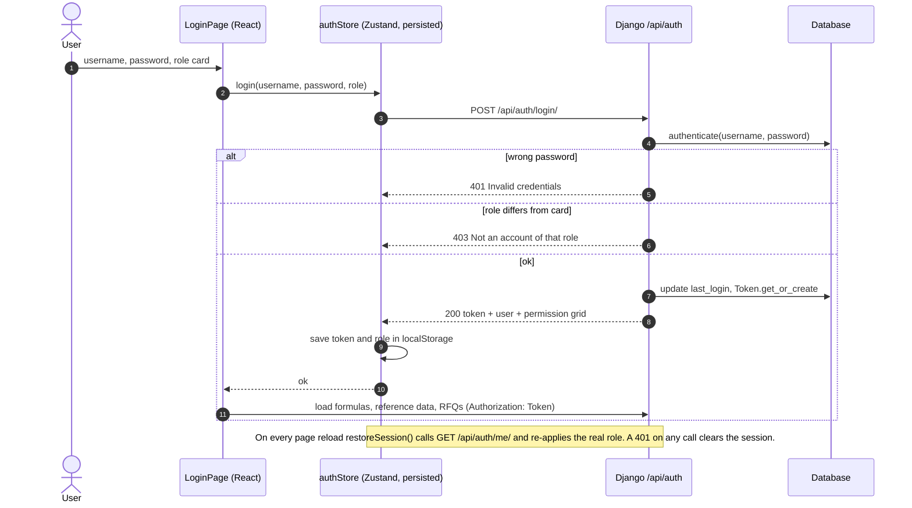

*Figure D7a. Login and session restore.* The password is checked first; only then is the chosen role card compared, so a wrong guess never reveals an account's role [Verified: `accounts/views.py:20-37`]. The token is reused across logins and stored in browser `localStorage`, where any script running on the page could read it (input to Part C).

##### Figure D7b — Create and submit an RFQ

Source: [`docs/diagrams/D7b_create_submit.mmd`](diagrams/D7b_create_submit.mmd)

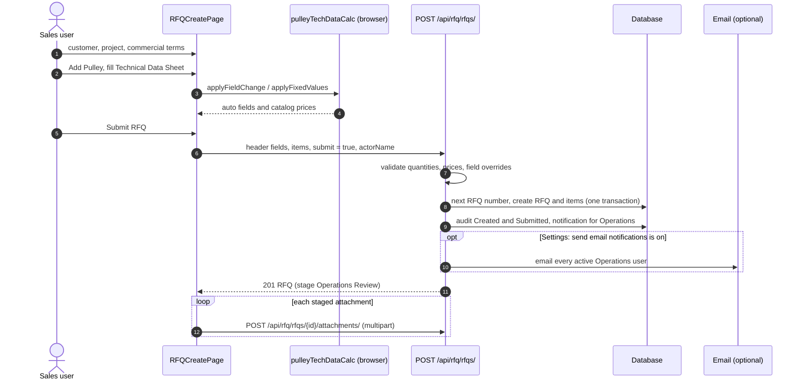

*Figure D7b. Creating and submitting an RFQ.* The sheet values, including all Auto fields, are calculated in the browser and saved as sent. The RFQ and its items are created in one database transaction; audit events and the notification are written after it. Attachments are uploaded one by one only after the RFQ exists; a failed upload shows a toast but does not undo the RFQ [Verified: `RFQCreatePage.tsx` `uploadPendingFiles`]. RFQ numbers are calculated as the highest existing number + 1 with the year fixed as `2026` (`rfq/id_utils.py`); two simultaneous creates could compute the same number and one would fail on the unique constraint [Inferred].

##### Figure D7c — Stage action: approve and send back

Source: [`docs/diagrams/D7c_stage_action.mmd`](diagrams/D7c_stage_action.mmd)

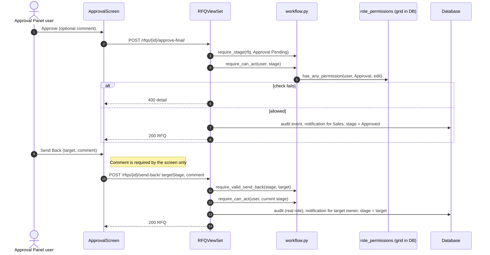

*Figure D7c. Approve and send back.* Each stage action checks the stage and the user's grid permission before writing the audit event, the notification and the new stage. Errors come back as HTTP 400 with a `detail` message. The send-back comment is required by the modal but not by the API.

##### Figure D7d — Pricing calculation

Source: [`docs/diagrams/D7d_pricing.mmd`](diagrams/D7d_pricing.mmd)

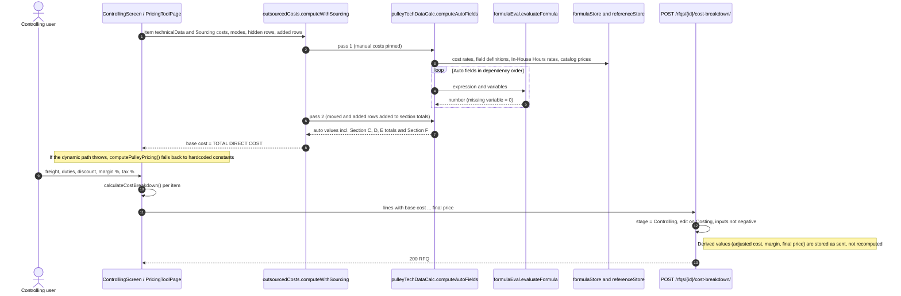

*Figure D7d. Pricing in the browser and saving Controlling's breakdown.* All cost figures are produced in the browser from the loaded formulas and reference data. The server checks only that the submitted inputs are not negative and stores the derived values unchanged, so the stored `final_price` and `rfq.value` depend on the browser's calculation.

##### Figure D7e — Quotation PDF and email

Source: [`docs/diagrams/D7e_quotation_pdf_email.mmd`](diagrams/D7e_quotation_pdf_email.mmd)

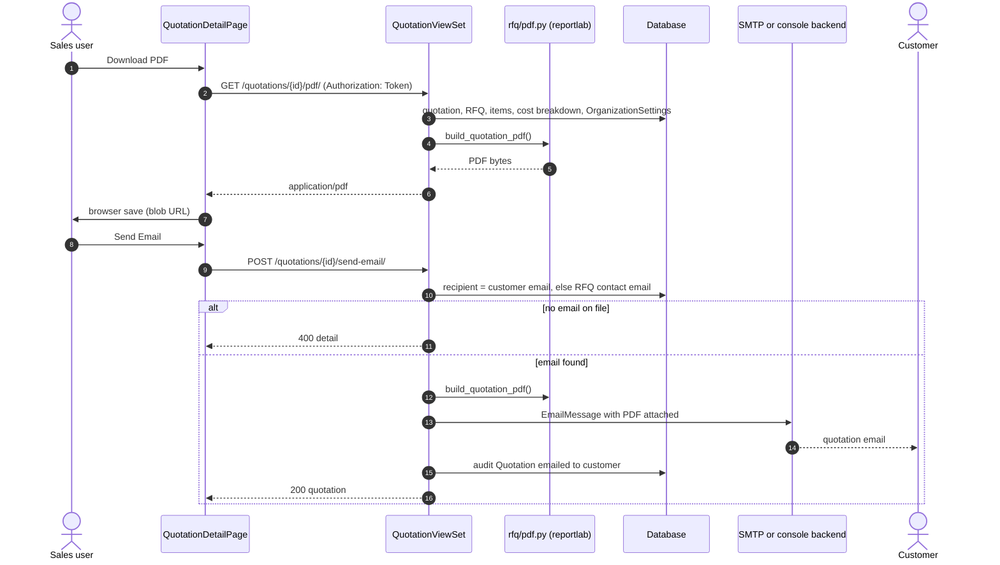

*Figure D7e. PDF download and quotation email.* The PDF is built fresh from the stored cost breakdown and current Settings on every request, so a quotation re-downloaded after a Settings change shows the new company details [Inferred]. Without SMTP settings the "email" is only written to the server log while the user sees a success toast [Verified: console backend; `QuotationDetailPage.tsx`].

---

## 6. Data design

> **TL;DR**
> - PostgreSQL in production (Neon, [To confirm]) and SQLite in development, accessed only through the Django ORM; 34 application tables across five apps (plus the DRF token table), created by 38 migrations.
> - RFQs use readable text primary keys and store timestamps as text; much per-item data (technical sheet, sourcing choices) is JSON.
> - Uploaded files live on the VPS disk; no backup, retention or archiving process exists in the repository.

### 6.1 Database engine

| Environment | Engine | Configuration | Label |
|---|---|---|---|
| Development | SQLite file `backend/db.sqlite3` | Default when `DATABASE_URL` is unset | [Verified: `settings.py`] |
| Production | PostgreSQL via `DATABASE_URL` (`dj_database_url`, persistent connections `conn_max_age=600`, driver `psycopg2-binary`) | Runbook: Neon with `sslmode=require` | [Verified code]; [To confirm] provider, plan, region, PostgreSQL version |

The ORM is the only data access; no raw SQL was found [Verified: no `.raw(`, `cursor(` or `.extra(` in backend app code, `grep` 2026-11-16].

### 6.2 Entity-relationship model

#### Figure D5 — Main models

Source: [`docs/diagrams/D5_er_diagram.mmd`](diagrams/D5_er_diagram.mmd)

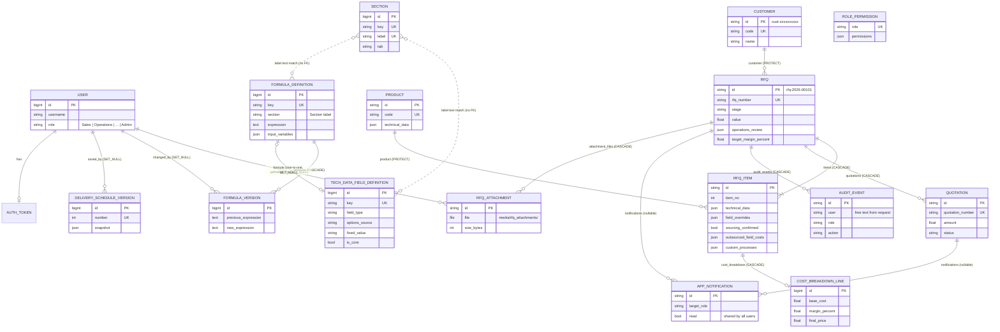

*Figure D5. Main models and relationships. Dotted lines = linked by a text value, not a foreign key.*

The RFQ is the centre of the model: it belongs to one customer (delete protected), owns its items, quotations, audit events, attachments and notifications (deleted with the RFQ), and each item points to a product (delete protected) and may have one cost-breakdown line. Formulas and sheet fields share a key through a one-to-one link; sections are joined to fields and formulas **by label text**, so a section rename updates rows in bulk rather than through a foreign key [Verified: `formulas/models.py` docstring]. Reference tables (Section 6.3) are standalone and only point to the user who last changed them. Audit events store the user **name as text** taken from the request body, so they survive user deletion but are not linked to an account [Verified: `rfq/models.py` `AuditEvent.user`].

### 6.3 Tables by app

| App | Tables (Django models) |
|---|---|
| `accounts` | `User` (custom, adds `role`), `RolePermission`; plus DRF `Token` |
| `formulas` | `Section`, `FormulaDefinition`, `TechDataFieldDefinition`, `FormulaVersion` |
| `reference` | `GlobalParameter`, `MaterialRate`, `MachiningLabourRate`, `LogisticsPackingRate`, `ShaftForgingBand`, `ShellForgingBand`, `BearingCatalogEntry`, `SleeveCatalogEntry`, `LagDataEntry`, `LcdDataEntry`, `HousingCatalogEntry`, `LaggingCatalogEntry`, `LockingDeviceCatalogEntry`, `OrganizationSettings` (single row, pk 1), `InHouseHourRate` |
| `rfq` | `Customer`, `Vendor`, `Product`, `RFQ`, `RFQItem`, `RFQAttachment`, `CostBreakdownLine`, `Quotation`, `AuditEvent`, `AppNotification` |
| `delivery` | `DeliveryActivity`, `DeliveryScheduleSettings` (single row), `DeliveryScheduleVersion` |

### 6.4 Design choices and their effects

| Choice | Effect | Evidence |
|---|---|---|
| Text primary keys (`rfq-2026-00101`, `cust-xxxxxxxxxx`) | Matches the frontend's string ids and readable URLs | `rfq/models.py` `generate_id` [Verified] |
| Timestamps on RFQ, quotation, audit, notification are `CharField` ISO text | Sorting works only while every value uses the same format; no date arithmetic in SQL | `rfq/models.py` [Verified] |
| Per-item JSON: `technical_data`, `field_overrides`, `process_vendors`, `process_costs`, `custom_processes`, `outsourced_field_*` | Flexible schema for an editable sheet; contents not validated by the database; cannot be queried efficiently | `RFQItem` [Verified] |
| Section linked by label | Simple rename cascade; no referential integrity | `formulas/models.py` [Verified] |
| `AuditEvent` with free-text user | Survives user deletion; user name can be supplied by the client | `rfq/views.py` `_actor` [Verified] |
| Notification `read` is one boolean per notification | Read state shared by everyone | `rfq/models.py` [Verified] |
| Choice fields not validated on save | e.g. quotation status accepts any text through the status endpoint | `rfq/views.py:273` [Verified] |

### 6.5 Migrations and seed data

| App | Migrations | With data steps (`RunPython`) |
|---|---|---|
| `accounts` | 3 | 0002 (superusers to Admin) |
| `delivery` | 6 | 0002 (workbook rows), 0004, 0006 |
| `formulas` | 9 | 0004, 0007, 0008, 0009 |
| `reference` | 12 | 0004, 0009, 0010, 0011, 0012 |
| `rfq` | 8 | none |
| **Total** | **38** | **13** |

All migrations are applied in the development database [Verified: `showmigrations`, 2026-11-16]. Production state [To confirm]. Seeding commands are listed in 5.3 and 5.8.2 (RB4, RB5).

### 6.6 Files

RFQ attachments are stored at `backend/media/rfq_attachments/<rfq id>/<10 hex chars>_<original name>` on local disk; allowed types `.pdf .doc .docx .xls .xlsx .png .jpg .jpeg`, maximum 15 MB each, 20 per RFQ; the extension is checked, the file content is not [Verified: `rfq/models.py`, `rfq/views.py` `validate_attachment_upload`]. The development folder `backend/media/rfq_attachments/rfq-2026-00101/` holds several hundred test PDFs (for example `f0.pdf` … `f19.pdf`, `drawing.pdf`) [Verified: file listing]; `media/` is excluded from Git (`backend/.gitignore` line 7; `git ls-files backend/media` returns 0 files) [Verified].

### 6.7 Backup, retention and data volume

| Topic | Finding | Label |
|---|---|---|
| Database backup | Nothing in the repository. Neon offers its own restore features depending on plan | [To confirm] |
| `media/` backup | Nothing in the repository | [To confirm] |
| Restore test | No record | [To confirm] |
| Retention / archiving | No deletion, archiving or anonymisation of RFQs, audit events, notifications or attachments in code | [Verified] |
| Audit trail growth | Grows without limit; returned in full to the browser on every login (no paging) | [Verified]; volume impact [Inferred] |
| Personal data stored | Customer and vendor contact names, emails, phones; user names and emails; RFQ contact details | [Verified: models] |

---

### Part B — inputs carried to Part C (Code quality and Security)

| From | Item |
|---|---|
| Part A | Missing security headers on `pricing.nxsys.in` (no HSTS, CSP, X-Frame-Options, X-Content-Type-Options in `curl -I`) |
| Part A | Audit events editable in Django admin; audit log readable by all; audit user name from request body |
| Part A / 5.7 | Comments, reasons, Operations checks, low-margin confirmation validated only in the browser (B1–B5) |
| Part A | Requirement 4.11 not implemented |
| Part A | "Reset Demo Data" does not reset |
| 5.7 | Endpoints E1–E6 with no check beyond login |
| 5.9.1 | Evaluator syntax mismatch; comprehensions allowed on server |
| 5.13.4 | Unawaited save-then-advance calls (R2) |
| 5.13.2 | No role guard on frontend routes |
| D7a | Token in `localStorage`; tokens never expire |
| 5.12 | Plain-text password in new-user email |
| 5.8.2 | Gunicorn missing from requirements; Nginx upload limit; `FRONTEND_URL` unset |
| 6.4 | Choice fields not validated (quotation status) |
| 6.6 | Attachment content (file type) not checked, only the extension |

### Part B — To-confirm items

Part A items TC-A1 to TC-A13 remain open. New items:

| # | Item | Question | Who can answer |
|---|---|---|---|
| TC-B1 | Gunicorn in production (RB1) | How was Gunicorn installed on the server, and which version runs? | Server administrator |
| TC-B2 | Nginx upload limit (RB2) | Does the production Nginx site set `client_max_body_size`? Have uploads over 1 MB been tested? | Server administrator |
| TC-B3 | Production Nginx config | Does the live Nginx config match the runbook (locations, headers, TLS settings)? Please share it with secrets removed. | Server administrator |
| TC-B4 | `vps_server_setup.md` (RB10) | Where is this referenced document kept? | Server administrator |
| TC-B5 | Seed commands in production (RB4) | Was `backfill_tech_data_fields` run in production? Was `seed_demo_rfqs` ever run there? | Developer |
| TC-B6 | Section C unit | Is the In-House Hours rate per hour or per minute? Should cost be rate × minutes (as coded) or rate × minutes ÷ 60? | Client (Controlling) |
| TC-B7 | Item total | Is quantity meant to be applied twice in "Item Total" (as in the workbook)? | Client (Controlling) |
| TC-B8 | Shaft material rate | Should the shaft rate come from the Raw Forging Prices table instead of fixed 310/330 INR/kg? (also questionnaire item 1) | Client (Controlling / Sourcing) |
| TC-B9 | Python and PostgreSQL versions in production | Which Python and PostgreSQL versions run in production? | Server administrator |
| TC-B10 | Neon region and connection | Which Neon region, plan and compute size? Is `sslmode=require` set in the production `DATABASE_URL`? | Server administrator |
| TC-B11 | Production data volume | How many RFQs, attachments (count and size) and audit events are in production today? | Server administrator |
| TC-B12 | Live formulas | Do production formulas still match the seeded set, or have they been edited? (export of `/api/formulas/` would answer) | Controlling / developer |

---

# Part C — Code quality and security

> **Baseline note.** On 2026-11-16 the working tree held uncommitted changes in 17 files and three untracked migrations (`backend/rfq/migrations/0006`–`0008`), last modified 12:46–15:23, before this review began. Parts A–C describe that working tree, not commit `b6b8664` alone. See TD-07 and TC-C1.

All findings below are listed with severity, evidence, reproduction, risk, fix, effort and status in **`docs/Tech_Debt_and_Security_Register.md`** (IDs `SEC-nn` and `TD-nn`). Reproduction tests and probe scripts are in `docs/evidence/`.

## 7. Code quality

> **TL;DR**
> - The backend is well tested: 320 tests pass and line coverage is 92%; the frontend, which holds all pricing logic, has no automated tests and there is no CI.
> - Type checking passes with 0 errors and lint findings are minor, but two backend functions are very complex (cyclomatic complexity 56 and 53) and one page file is 2,110 lines.
> - The main debt is duplicated logic between browser and server, plus one dependency with three published vulnerabilities (DRF 3.18.1).

### 7.1 Method and tools

All commands ran on 2026-11-16 against a local copy. Analysis tools were installed in an isolated scratch environment outside the project; the project and its dependencies were not changed. The backend tests used a scratch settings module that only redirects `MEDIA_ROOT` so test uploads did not touch `backend/media/` (`docs/evidence/scratch_settings.py`).

| Tool | Version | Scope | Result summary |
|---|---|---|---|
| Django test runner + coverage | Django 6.1.1, coverage 7.13.5 | `backend/` apps, excluding migrations and test files from coverage | **320 tests, OK, 396.9 s; 92% line coverage** |
| ruff | 0.17.5 | `backend/`, excluding migrations | Legacy E/F rules: 12 issues; ruff 0.17.5 defaults: 412 (286 are RUF012 on Django class lists); bugbear/bandit/complexity/Django rules on app code: 43; format check: 122 of 154 files would change |
| radon | 6.0.1 | `backend/` app code | 429 blocks, average complexity A (3.66); 15 blocks rank C or worse |
| pip-audit | 2.10.1 | `backend/requirements.txt` | **3 known vulnerabilities in 1 package** (djangorestframework 3.18.1) |
| `manage.py check --deploy` | Django 6.1.1 | Settings with `DEBUG=false` and a dummy key passed through the environment | 1 warning: `security.W004` (HSTS not set) |
| TypeScript `tsc --noEmit` | 6.0.3 | `tsconfig.app.json` | **0 errors** |
| oxlint | 1.80.0 | `src/` | **0 errors, 21 warnings** (19 react-hooks/exhaustive-deps) |
| npm audit | npm 11.9.0 | all / `--omit=dev` | 2 high (dev tooling only) / **0** |
| npm outdated, `pip index versions` | — | dependencies | Patch and minor updates available (7.6) |
| Not available | — | — | No JavaScript complexity tool or frontend coverage tool (no frontend tests exist) |

### 7.2 Structure

| Aspect | Finding | Evidence |
|---|---|---|
| Layout | Backend: one Django app per domain (`accounts`, `formulas`, `reference`, `rfq`, `delivery`). Frontend: `features/` per screen, shared `components/`, `lib/` for logic, `store/` for state. Clear and conventional | Sections 5.1, 5.13.1 [Verified] |
| Naming | Consistent: snake_case in Python, camelCase in TypeScript, converted generically by `CamelCaseSerializer` (`rfq/serializers.py`) | [Verified] |
| Module size | Largest files: `FormulasPage.tsx` 2,110 lines; `DeliverySchedulePage.tsx` 1,088; `formulas/views.py` ≈ 720; `rfq/views.py` ≈ 920 (maintainability index B, the only file below A) | `wc -l`, `radon mi` [Verified] |
| Duplicated logic | Five pairs maintained by hand in two places: formula evaluator, workflow rules, critical path, dynamic vs static pricing, catalogs (TD-09) | [Verified] |
| Dead code | Unused exports and one unused endpoint (TD-19) | `grep` reference counts [Verified] |
| Comments | Unusually thorough docstrings explaining *why*; several refer to an older design ("frontend-only", "mock") and are now stale | e.g. `src/lib/pricing.ts` header "Mock commercial pricing formulas" [Verified] |

### 7.3 Tests

**Backend suite** (`docs/evidence/test_results.txt`) [Verified]:

| App | Tests | Statements | Covered | Coverage |
|---|---|---|---|---|
| `accounts` | 46 | 267 | 262 | 98.1% |
| `delivery` | 53 | 382 | 377 | 98.7% |
| `formulas` | 105 (92 + 13 bulk import) | 1,092 | 1,013 | 92.8% |
| `reference` | 39 | 528 | 512 | 97.0% |
| `rfq` | 77 | 1,438 | 1,229 | 85.5% |
| **Total** | **320 passed, 0 failed, 0 skipped** | 3,707 | 3,393 | **92%** |

Lowest-covered files: `rfq/management/commands/seed_demo_rfqs.py` 0%, `rfq/id_utils.py` 82%, `formulas/bulk_import.py` 87%, `formulas/catalog_options.py` 89%, `rfq/views.py` 90%.

**Areas with no or weak tests** [Verified]:

| Area | Gap |
|---|---|
| Pricing calculation (Sections A–F, Sourcing adjustments, Controlling breakdown) | Lives only in the browser (`src/lib/`); **no frontend tests at all** — no test files, no test script |
| Formula evaluator parity | No test that the Python and TypeScript evaluators agree (they do not — SEC-14) |
| Workflow — negative cases | `rfq/workflow.py` is 100% covered, but no test checks that the wrong role or stage is refused on generate-quotation, send-quotation, quotation status or send-email (SEC-01 went unnoticed) |
| Business rules B1–B5 | Not tested on the server because they are not implemented there |
| PDF content | Tests build the PDF but do not check escaping of user text (SEC-15) |
| Browser flows | No end-to-end tests (e.g. Playwright) for the six-role workflow |

**Reproduction tests written for this review** (`docs/evidence/findings_tests.py`, not part of the project): 26 tests, all passing — 19 reproduce findings and 7 confirm that existing controls work (wrong role refused, invalid send-back target refused, login role mismatch refused, Sales cannot write formulas, bad extension refused, no code execution in formulas). One PDF payload had to be changed (first payload `<font` did not fail; `` did) — recorded in `test_results.txt`.

### 7.4 Static analysis

| Check | Result | Notes |
|---|---|---|
| ruff, legacy rule set (E4, E7, E9, F) | 12: 7 × E741 ambiguous name, 3 × F401 unused import (`rfq/views.py:49-51`), 1 × E731, 1 × F841 (`rfq/pdf.py:82`) | Minor |
| ruff 0.17.5 default rule set | 412 (286 RUF012, 57 C408, 30 I001, 17 RUF059 …); 250 in app code | Mostly style; RUF012 is a false positive for Django `Meta` and `fields` lists |
| ruff B, S, C90, DJ on app code | 43: 12 B904, 8 C901, 8 DJ001 (nullable string fields), 5 DJ008, 5 B023 (loop variable in closure, `seed_demo_rfqs.py:272-275`), 1 S105 (the deliberate insecure default key name, guarded in `settings.py`) | B023 is a real bug risk in the demo seeder only |
| ruff format | 122 of 154 files would be reformatted | No formatter has been applied |
| tsc | 0 errors | Strict typing holds |
| oxlint | 0 errors, 21 warnings: 19 react-hooks/exhaustive-deps (mostly `FormulasPage.tsx:332-333`), 1 react(purity), 1 only-export-components | Hook warnings can mean stale values on screen |

### 7.5 Complexity hotspots (top 10)

| # | Item | Measure | Evidence |
|---|---|---|---|
| 1 | `TechDataFieldDefinitionViewSet.perform_update` | Cyclomatic complexity 56 (radon F) | `backend/formulas/views.py:452` |
| 2 | `DeliveryScheduleView.put` | CC 53 (F) | `backend/delivery/views.py:220` |
| 3 | `src/features/formulas/FormulasPage.tsx` | 2,110 lines, 11 components in one file | `wc -l` |
| 4 | `backfill_tech_data_fields` `Command.handle` | CC 31 (E) | `backend/formulas/management/commands/` |
| 5 | `src/features/costrates/DeliverySchedulePage.tsx` | 1,088 lines | `wc -l` |
| 6 | `critical_path` | CC 26 (D) | `backend/delivery/calc.py:67` |
| 7 | `BulkImporter.import_fields` | CC 24 (D) | `backend/formulas/bulk_import.py:217` |
| 8 | `RFQViewSet.update_details` | CC 21 (D) | `backend/rfq/views.py:478` |
| 9 | `validate_field_overrides`, `resolve_expression_variables` | CC 20 and 19 (C) | `backend/rfq/views.py:143`, `backend/formulas/views.py:143` |
| 10 | `src/features/pricingtool/PricingToolPage.tsx` and `src/lib/outsourcedCosts.ts` | 732 lines; two-pass calculation with pins and adds | `wc -l`, Section 5.9.5 |

### 7.6 Dependencies

| Package | Pinned | Latest seen | Note |
|---|---|---|---|
| djangorestframework | 3.18.1 | 3.18.3 | **3 CVEs, fixed in 3.18.2 (SEC-16)** |
| Django | 6.1.1 | 6.1.3 | Two patch releases; release notes to review (TC-C4) |
| reportlab | 5.0.1 | 5.1.0 | Minor |
| asgiref, python-dotenv, sqlparse, tzdata | 3.12.1, 1.2.3, 0.6.0, 2026.4 | 3.13.0, 1.2.4, 0.6.1, 2026.6 | Minor |
| simpleeval, openpyxl, psycopg2-binary, dj-database-url, django-cors-headers | current | — | Up to date |
| gunicorn | — | — | **Missing from requirements (TD-02)** |
| vite | 8.2.2 | 8.3.8 | 2 high advisories, development server only (SEC-17) |
| react, react-dom, react-router-dom, zustand, driver.js, lucide-react | ^ ranges | newer minors available | `npm outdated` |
| typescript | 6.0.3 | 7.0.2 | Major version available; not urgent |

No unmaintained packages were identified; maintenance status beyond version recency was not assessed [To confirm].

### 7.7 Scorecard

| Area | Grade | Evidence |
|---|---|---|
| Backend tests | **A−** | 320 passing, 92% coverage; missing negative permission tests (TD-24) |
| Frontend tests | **D** | None, although pricing logic lives there (TD-08) |
| Static analysis | **B** | `tsc` 0 errors; oxlint 0 errors; 12 legacy ruff issues; no formatter or lint config enforced (TD-20) |
| Complexity and size | **C** | Two functions at CC > 50; 2,110-line page (TD-11) |
| Duplication and consistency | **C** | Five duplicated logic pairs, two already diverging (TD-09, TD-10, SEC-14) |
| Dependencies | **C** | One package with 3 CVEs; Gunicorn missing (SEC-16, TD-02) |
| Build, CI and release | **D** | No CI; uncommitted work including migrations; manual deploys (TD-07, TD-08) |
| Documentation in repository | **C** | Good docstrings; user and ops documents out of date (TD-23) |

### 7.8 Prioritised technical debt

1. **TD-07** commit and tag; **TD-02** Gunicorn; **TD-03** Nginx upload limit — release safety (S each).
2. **TD-01** await save-then-advance — data loss (S).
3. **TD-04, TD-06, TD-05** — confirm and fix calculation questions with the client (S–M).
4. **TD-08 + TD-24** — Vitest for `src/lib/*`, negative API tests, CI pipeline (L).
5. **TD-09 / SEC-14** — shared formula grammar and conformance tests (M), then other duplicated pairs (L).
6. **TD-10** Sourcing summary consistency (M).
7. **TD-11** split the two F-rank functions and FormulasPage (L).
8. **TD-12** pagination (M); **TD-14** real date fields (M).
9. **TD-13** requirement 4.11 (L, needs client decision).
10. Low items: TD-15 to TD-23.

---

## 8. Security

> **TL;DR**
> - No path to run arbitrary code was found: formulas cannot call functions outside a whitelist or reach Python attributes, and the ORM is used throughout. Key controls (password check, stage checks on most actions, private file storage, HTTPS redirect, secure cookies) work.
> - The main weaknesses are access control on quotation endpoints (any role can generate, send and close quotations), business rules enforced only in the browser, an editable and spoofable audit trail, passwords sent by email, and a dependency with three published vulnerabilities.
> - Most fixes are small; a fix-now list of 13 items is in the register.

### 8.1 Scope and method

Code and configuration of both applications were reviewed against the OWASP Top 10 (2021) and OWASP ASVS 4.0 chapter headings. Behaviour was confirmed with 26 reproduction tests on a throwaway database and a separate evaluator probe (Section 7.3). The live site was touched only by the one approved `curl -I`. No scanner, login or state-changing request was made against production. Hosting controls (firewall, SSH, backups) are covered in Part D.

**Controls verified as working** [Verified: tests or code]:

| Control | Evidence |
|---|---|
| Password checked before the role card, so a wrong guess never reveals a role | `accounts/views.py:20-37`; `test_login_role_mismatch_rejected` |
| Stage and grid checks on 24 RFQ action routes; wrong role or wrong stage refused | `rfq/workflow.py`; `test_stage_action_rejected_for_wrong_role`, `test_send_back_to_invalid_target_rejected` |
| Master data and formulas writable only by Masters/Costing holders | `test_formula_write_forbidden_for_sales` |
| Server refuses to start with the default secret key when `DEBUG=false` | `settings.py:25-29` |
| HTTPS redirect, secure session and CSRF cookies, proxy SSL header when `DEBUG=false` | `settings.py:125-129`; `check --deploy` |
| Attachments not publicly served; download only through authenticated API, as attachment | `settings.py` `MEDIA_ROOT` comment; `rfq/views.py:731-735` |
| Attachment extension allow-list, 15 MB and 20-file limits | `test_attachment_bad_extension_rejected` |
| ORM only; no raw SQL | `grep` (Section 6.1) |
| Catalog lookups use a fixed allow-list, never user input as model or field names | `reference/views.py` `REFERENCE_DROPDOWN_FIELDS` |
| Formula evaluation cannot run code (8.4) | `test_no_code_execution`; `eval_probe_result.txt` |
| React escapes rendered text; no `dangerouslySetInnerHTML` found | `grep -rn dangerouslySetInnerHTML src` → 0 [Verified] |
| Email templates use Django auto-escaping | `accounts/templates/accounts/email/new_user.html` |

### 8.2 Findings by OWASP Top 10 (2021)

| OWASP category | Findings |
|---|---|
| A01 Broken access control | **SEC-01** (High), SEC-02, SEC-03, SEC-19 |
| A02 Cryptographic failures | **SEC-10** (High), SEC-22 |
| A03 Injection | SEC-15 (reportlab markup) |
| A04 Insecure design | SEC-06, SEC-13, SEC-14, SEC-18 |
| A05 Security misconfiguration | SEC-08, SEC-20, SEC-22 |
| A06 Vulnerable and outdated components | **SEC-16** (High), SEC-17 |
| A07 Identification and authentication failures | SEC-09, SEC-11, SEC-12, SEC-21 |
| A08 Software and data integrity failures | SEC-07, SEC-14 |
| A09 Security logging and monitoring failures | SEC-04, SEC-05, SEC-23 |
| A10 Server-side request forgery | SEC-15 (`` URL fetch, [Inferred]) |

### 8.3 Review by ASVS area

| ASVS area | Summary | Findings |
|---|---|---|
| V2 Authentication | Username/password with token. No throttling; password validators not applied on user creation; initial passwords emailed; Django admin password-only | SEC-10, SEC-11, SEC-12, SEC-21 |
| V3 Session management | DRF tokens never expire, reused across logins, stored in `localStorage`; logout deletes the token | SEC-09 |
| V4 Access control | Grid enforced on stage actions and master data; quotation, notification and audit endpoints login-only; reads unscoped; browser uses fixed role names | SEC-01, SEC-02, SEC-03, SEC-19 |
| V5 Validation and encoding | ORM and DRF serializers for most input; RFQ actions read raw `request.data`; free-text status accepted; user text injected into PDF markup | SEC-01, SEC-06, SEC-07, SEC-15 |
| V7 Logging | Workflow audit exists, but actor name is client-supplied, rows editable in admin, readable by all; no security logging | SEC-03, SEC-04, SEC-05, SEC-23 |
| V8 Data protection | Personal data: customer/vendor contacts, user names and emails. No retention policy; no export or deletion process | Section 6.7; TC-C9 |
| V12 Files | Extension and size checks; no content check; stored outside web root | SEC-18 |
| V13 API | No rate limiting, no paging, no versioning | SEC-11, TD-12 |
| V14 Configuration | Secret-key guard good; HSTS and other headers missing; CORS tied to `DEBUG`; vulnerable DRF; Gunicorn unpinned | SEC-08, SEC-16, SEC-20, TD-02 |
| CSRF | Session authentication (Django admin and DRF session) uses CSRF middleware; the SPA uses a header token, which is not sent automatically by browsers, so CSRF does not apply to it | `settings.py` middleware and `REST_FRAMEWORK` [Verified] |
| XSS | React escaping; no raw HTML rendering found. Without CSP (SEC-08) any future injection would expose the `localStorage` token | [Verified] / [Inferred] |
| Secrets | Setting names only in this review. `SECRET_KEY`, `DATABASE_URL`, `EMAIL_HOST_PASSWORD` are read from `backend/.env` (`python-dotenv`); `.env` is git-ignored (`backend/.gitignore`) | [Verified]; file permissions on the server [To confirm] |
| Database (Neon) | Connection security, credential rotation, least-privilege role and region not verifiable from the repository | SEC-22, TC-B10 |

### 8.4 Formula evaluator review

**Plain statement.** Arbitrary code **cannot** be run through a formula, on either side [Verified]:

| Question | Server (`simpleeval` 1.0.8, `EvalWithCompoundTypes`) | Browser (`formulaEval.ts`) | Evidence |
|---|---|---|---|
| `eval` / `exec` / `import` / `open` | Rejected: "Function … not defined" | No such functions; parse error | `eval_probe_result.txt`; `test_no_code_execution` |
| Attribute access (`(1).__class__`) | Rejected: "access to __attributes … is not available" | No `.` operator for names | same |
| Lambdas, assignment | Rejected | Not in grammar | same |
| Comprehensions | **Allowed** (`[x*2 for x in [1,2,3]][2]` = 6); nested 10 × 10 allowed | Not in grammar | `eval_probe_result.txt` |
| Large lists | `[0]*10000000` rejected ("will not evaluate something that long") | — | same |
| Large exponents via `pow()` | `pow(10, 10000000)` rejected | `Math.pow` returns `Infinity` quickly | same |
| Large exponents via `**` | `9**3999999` takes **1.73 s**; `3999999**3999999` **did not finish in 20 s** — a worker would be blocked (SEC-13) | `**` not supported | same |
| Unknown variable | 0 (`__builtins__` → 0, harmless) | 0 | same |

So the server evaluator is **safe from code execution but not from CPU exhaustion**, and only users who can save formulas (Controlling, Admin) can reach it (`MasterDataPermission`). Gunicorn's default 30-second worker timeout would eventually kill such a request [Inferred from Gunicorn defaults; production setting To confirm].

**Recommendation — one grammar for both evaluators.** Define the grammar once and enforce it on both sides:

```
expression  := comparison
comparison  := additive ( ( ">" | "<" | ">=" | "<=" | "==" | "!=" ) additive )?
additive    := term ( ( "+" | "-" ) term )*
term        := unary ( ( "*" | "/" ) unary )*
unary       := "-" unary | primary
primary     := NUMBER | IDENTIFIER | call | "(" expression ")"
call        := FUNCTION "(" expression ( "," expression )* ")"
FUNCTION    := "min" | "max" | "round" | "abs" | "sqrt" | "pow" | "iff"
NUMBER      := digits [ "." digits ]          (no exponent notation)
IDENTIFIER  := letter ( letter | digit | "_" )*   (no dots)
constants   := PI
```

1. **Server:** before evaluating, walk the Python AST and reject any node outside this grammar (no `Pow`, `Mod`, `FloorDiv`, `IfExp`, `BoolOp`, comprehensions, lists, strings, attributes). Use simpleeval's plain `SimpleEval` instead of `EvalWithCompoundTypes`. Bound `pow` (for example |exponent| ≤ 100 and |result| ≤ 10¹⁵) and treat non-finite results as errors.
2. **Browser:** keep the existing parser, which already matches this grammar.
3. **Conformance file:** one JSON file of `{expression, variables, expected result or error}` cases run by both the Django test suite and a Vitest suite, so the two cannot drift.
4. **No silent fallback:** when the dynamic calculation fails, show the error on the screen and block saving the cost breakdown, instead of switching to hard-coded values (SEC-14).

### 8.5 Threat model (STRIDE)

S = Spoofing · T = Tampering · R = Repudiation · I = Information disclosure · D = Denial of service · E = Elevation of privilege. "Control" = what exists today; "Gap" links to the register.

#### 8.5.1 Login

| Threat | Example | Control today | Gap |
|---|---|---|---|
| S | Password guessing | Password hashing (Django) | No throttling (SEC-11); weak passwords accepted on create (SEC-12) |
| T | Modify stored role in browser to see other pages | `restoreSession` re-reads the role from `/auth/me/`; API checks role | Routes not role-guarded (SEC-19) |
| R | Deny having logged in | `last_login` updated | No login/failure log (SEC-23) |
| I | Token theft from `localStorage`; password in welcome email | HTTPS | No CSP (SEC-08); token never expires (SEC-09); emailed password (SEC-10) |
| D | Flood login or send crafted headers | — | No rate limit (SEC-11); DRF DoS CVEs (SEC-16) |
| E | Non-Admin uses Django admin | Admin requires `is_staff` | `/admin/` public, password-only (SEC-21) |

#### 8.5.2 RFQ submit

| Threat | Example | Control today | Gap |
|---|---|---|---|
| S | Submit under another person's name | Role taken from the token | `actorName` written to audit as sent (SEC-04) |
| T | Send manipulated technical data or auto-field values | Quantity > 0 and prices ≥ 0 checked | Sheet values stored as sent; no server recalculation (SEC-07 pattern) |
| R | Deny creating an RFQ | Audit event "Created RFQ" | Audit editable in admin (SEC-05) |
| I | Read other customers' RFQs and attachments | Login required | All roles read all RFQs and attachments (SEC-03) |
| D | Upload large or many files | 15 MB, 20 files per RFQ, extension list | No content check (SEC-18); Nginx limit unknown (TD-03) |
| E | Create RFQ without Sales rights | Deliberately open to all roles | Business decision (TC-C8) |

#### 8.5.3 Stage actions (approve, send back, reject, quotation)

| Threat | Example | Control today | Gap |
|---|---|---|---|
| S | Act as another role | Token-based role, grid check | — |
| T | Skip stages; approve without checks; change final price | `require_stage` + `require_can_act` on 24 action routes | Quotation endpoints unprotected (SEC-01); browser-only rules (SEC-06); derived prices trusted (SEC-07) |
| R | Deny sending back or rejecting | Audit event with real role | Empty comment allowed (SEC-06); spoofable name (SEC-04); editable audit (SEC-05) |
| I | See approvals and audit history of other teams | — | Audit log open to all (SEC-03) |
| D | Mark all notifications read for everyone | — | SEC-02 |
| E | Sales or Operations closes a quotation as Won | — | SEC-01 |

#### 8.5.4 Formula editing

| Threat | Example | Control today | Gap |
|---|---|---|---|
| S | Non-Controlling user edits formulas | `MasterDataPermission` | — |
| T | Change a formula so prices silently fall back or change | Server validation, `FormulaVersion` history | Grammar mismatch and silent fallback (SEC-14); no approval step for formula changes |
| R | Deny changing a formula | `FormulaVersion.changed_by` | Reference-table edits keep only the last editor (Section 5.10) |
| I | Read all formulas and rates | Reads open to all roles | Policy decision (TC-C8) |
| D | `3999999**3999999` hangs a worker | Gunicorn timeout [Inferred] | SEC-13 |
| E | Code execution through an expression | simpleeval whitelist; browser parser | None found (8.4) |

#### 8.5.5 Quotation email

| Threat | Example | Control today | Gap |
|---|---|---|---|
| S | Email sent by a role that should not | — | Any role can send (SEC-01) |
| T | Inject markup into the PDF through project or customer text | — | SEC-15 |
| R | Deny sending a quotation | Audit "Quotation emailed to customer" | Spoofable name (SEC-04) |
| I | Quotation sent to the wrong address; server reads a local image into the PDF | Recipient from customer master, else RFQ contact | No confirmation of recipient in UI; SEC-15 |
| D | Malformed text stops PDF generation | — | SEC-15 |
| E | — | — | — |

### 8.6 Fix now versus larger work

| Fix now (S effort, low risk) | Larger work (M–L) |
|---|---|
| SEC-16 upgrade DRF | SEC-07 server-side price recalculation |
| SEC-01 role and stage checks on quotation endpoints | SEC-09 expiring tokens / cookie sessions |
| SEC-15 escape PDF text | SEC-10 set-password link flow |
| SEC-08 security headers + HSTS | SEC-13 / SEC-14 shared grammar, AST whitelist, conformance tests |
| SEC-05 read-only audit admin | SEC-19 permission-driven UI |
| SEC-04 audit user from token | SEC-02 per-user notification state |
| SEC-06 server-side comment, reason and check validation | SEC-23 security logging and monitoring |
| SEC-10 (interim) stop emailing passwords | TD-08 frontend tests and CI |
| SEC-11 login throttle; SEC-12 password validators | SEC-22 Neon hardening (after confirmation) |
| SEC-03 restrict audit log to Admin | SEC-18 file content checks |
| TD-02 Gunicorn, TD-03 upload limit, TD-07 commit work | — |

---

### Part C — To-confirm items

Open from Parts A and B: TC-A1 to TC-A13 and TC-B1 to TC-B12 remain open; none was answered by Part C. TC-A4 (deployed commit) is now more important because of the uncommitted work (TC-C1).

| # | Item | Question | Who can answer |
|---|---|---|---|
| TC-C1 | Uncommitted work | Who owns the 17 modified files and 3 untracked migrations (`rfq/0006`–`0008`)? Are they deployed anywhere, and when will they be committed? | Developer |
| TC-C2 | Production email backend | Is SMTP configured in production? If not, new-user emails (with passwords) are written to the server log — has that log been reviewed and cleared? (relates to TC-A8) | Server administrator |
| TC-C3 | Django admin exposure | Is `/admin/` reachable from the internet, or restricted by IP or VPN? Which accounts are staff or superusers? | Server administrator |
| TC-C4 | Django patch releases | Do Django 6.1.2 / 6.1.3 contain security fixes relevant to this app? (release notes not reviewed here) | Developer |
| TC-C5 | Gunicorn timeout and workers | What `--timeout` and worker count run in production? (affects SEC-13 and the DRF DoS CVEs) | Server administrator |
| TC-C6 | Secrets on the server | What are the owner and permissions of `backend/.env` on the VPS, and when were `SECRET_KEY` and the database password last rotated? | Server administrator |
| TC-C7 | Neon database role | Does the application connect as the database owner or a least-privilege role? (relates to TC-B10) | Server administrator |
| TC-C8 | Data visibility policy | Should every role see every RFQ, quotation, attachment, formula and the audit log, or only what their stage needs? Should every role be allowed to create RFQs? | Client management |
| TC-C9 | Data protection obligations | Which data-protection rules apply to customer and staff personal data (retention, deletion, residency)? Professional review recommended | Client legal / compliance |
| TC-C10 | Formula change control | Should formula and rate changes need a second approval before affecting live prices? | Client management (Controlling) |

---

# Part D — Hosting, operations, risks, decisions, roadmap, appendices

> **Baseline reminder.** This document describes Git commit `b6b8664` **plus uncommitted work from 2026-11-16** (17 modified files and three untracked migrations `backend/rfq/migrations/0006`–`0008`). Production, if deployed with `git pull` as the runbook says, cannot contain that work. See TD-07, TC-C1 and Section 12.

## 9. Hosting and deployment

> **TL;DR**
> - The runbook describes one VPS shared with 11 other applications: Nginx serves the React build and proxies `/api/` and `/admin/` to Gunicorn on port 8012; the database is an external Neon PostgreSQL; TLS comes from certbot.
> - Only three facts were observed directly: the site answers over HTTPS, the server is `nginx/1.24.0 (Ubuntu)`, and no security headers are sent. The provider (Hostinger), plan, OS version, specs, cost, backups, monitoring, RPO and RTO are [To confirm].
> - Before the next release: put Gunicorn in `requirements.txt`, raise the Nginx upload limit, align timeouts, commit outstanding work, and set up backups for both Neon and `media/`.

### 9.1 What is known

| Item | Value | Source | Label |
|---|---|---|---|
| Provider | Hostinger | Stated by the project owner | [To confirm] (not in the repository) |
| Plan type | VPS (the runbook uses `sudo`, `systemd`, its own Nginx and certbot, which a shared plan does not allow) | `DEPLOYMENT_RUNBOOK.md` | [Inferred]; plan name, CPU, RAM, disk, cost [To confirm] |
| Operating system | Ubuntu; `nginx/1.24.0 (Ubuntu)` is the version shipped with Ubuntu 24.04 | `curl -I` 2026-11-16 | Ubuntu [Verified]; 24.04 [Inferred] |
| Shared server | 11 other applications on ports 8000–8011 | Runbook header | [To confirm] |
| Domain | `pricing.nxsys.in` | Runbook; `curl -I` | [Verified] responds; DNS provider [To confirm] |
| TLS | Let's Encrypt via `certbot --nginx` | Runbook Step 8; HTTPS works | Certificate issuer and auto-renewal [To confirm] |
| Web server | Nginx site `pricing`: `/` → `dist/`, `/static/` → `backend/staticfiles/`, `/api/` and `/admin/` → `127.0.0.1:8012`, `proxy_read_timeout 60s` on `/api/` | Runbook Step 7 | Production file [To confirm] (TC-B3) |
| Application server | Gunicorn, systemd unit `gunicorn-pricing`, user `pricingadmin`, group `www-data`, 3 workers, no `--timeout` (Gunicorn's documented default is 30 s) | Runbook Step 6 | Unit as written [Verified]; running config [To confirm] (TC-C5) |
| Application path | `/var/www/pricing` (frontend at root, backend in `backend/`) | Runbook | [To confirm] |
| Database | Neon PostgreSQL via `DATABASE_URL` with `sslmode=require` | Runbook Prerequisites | [To confirm] (TC-A7, TC-B10) |
| Static files | `collectstatic` into `backend/staticfiles/` (`STATIC_ROOT`) | `settings.py:101-102` | [Verified] |
| Uploaded files | `backend/media/` (`MEDIA_ROOT`), private, served only by the API | `settings.py:107` | [Verified]; on the server [To confirm] |
| Frontend config | `VITE_API_BASE_URL=https://pricing.nxsys.in/api` written to `.env.production` at build | Runbook Step 5 | [To confirm] |
| Deploy method | Manual `git pull` from `main`, then pip, migrate, collectstatic, `npm run build`, restart | Runbook "Routine Update" | [To confirm] (TC-A10) |
| CI/CD, containers | None in the repository (no `.github/`, CI file or Dockerfile) | File listing | [Verified] |

#### Figure D4 — Deployment

Source: [`docs/diagrams/D4_deployment.mmd`](diagrams/D4_deployment.mmd)

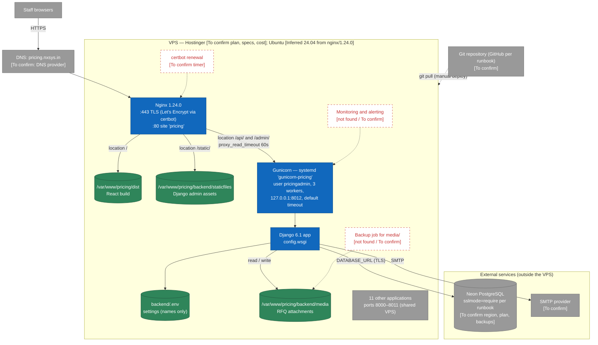

*Figure D4. Deployment as described by the runbook. Blue = processes; green = files on the VPS; grey = external services; red dashed = expected but not found or not verified.*

Browsers resolve `pricing.nxsys.in` and connect to Nginx over HTTPS. Nginx serves the React build and Django admin assets directly, and forwards `/api/` and `/admin/` to Gunicorn on the loopback interface, so Gunicorn is not exposed to the internet [Verified: runbook binds `127.0.0.1:8012`]. Django reads its settings from `backend/.env`, stores attachments in `backend/media/`, and talks to Neon over TLS and to an SMTP provider. The VPS also runs 11 other applications, so CPU, memory and disk are shared and one application's load or compromise can affect the others [Inferred]. Three things expected in a production setup were not found in the repository or runbook: a certbot renewal check, a backup job for `media/`, and monitoring or alerting.

### 9.2 Timeouts and long-running requests

| Step | Limit | Source | Effect |
|---|---|---|---|
| Nginx → Gunicorn (`/api/`) | 60 s read timeout | Runbook | [Verified] |
| Nginx → Gunicorn (`/admin/`) | Nginx default (60 s) | Runbook has none | [Inferred] |
| Gunicorn worker | 30 s default (no `--timeout`) | Runbook Step 6; Gunicorn documentation | A request longer than 30 s is killed before Nginx's 60 s, giving a 502 [Inferred] |
| Quotation PDF | Built synchronously in the request (`rfq/pdf.py`) | Code | Normally fast; a large RFQ or an `` fetch in user text (SEC-15) could approach the worker timeout [Inferred] |
| Quotation and notification email | Sent synchronously; no `EMAIL_TIMEOUT` in `settings.py` | Code | A slow or unreachable SMTP server holds the worker until Gunicorn kills it [Inferred] |
| Formula preview / save | Synchronous evaluation | Code | `**` with huge numbers blocks a worker (SEC-13) |
| Workers | 3 | Runbook | Three slow requests at once make the whole API unresponsive [Inferred] |

### 9.3 Settings (names only)

| Name | Used for | Read by |
|---|---|---|
| `SECRET_KEY` | Django signing; startup refused if default and `DEBUG=false` | `settings.py` |
| `DEBUG` | `false` in production; also controls HTTPS redirect, secure cookies and CORS | `settings.py` |
| `ALLOWED_HOSTS` | Host header allow-list | `settings.py` |
| `CORS_ALLOWED_ORIGINS` | Allowed browser origins when `DEBUG=false` | `settings.py` |
| `DATABASE_URL` | PostgreSQL connection (SQLite if unset) | `dj_database_url` in `settings.py` |
| `EMAIL_HOST`, `EMAIL_PORT`, `EMAIL_HOST_USER`, `EMAIL_HOST_PASSWORD`, `EMAIL_USE_TLS`, `DEFAULT_FROM_EMAIL` | SMTP; console backend when `EMAIL_HOST_USER` is unset | `settings.py` |
| `VITE_API_BASE_URL` | Frontend build: API base URL | `src/lib/apiClient.ts:18`; `.env.production` |
| `FRONTEND_URL` | Read by `accounts/email.py` but **never set** in settings (TD-18) | — |

Values are stored in `backend/.env` on the server, which is excluded from Git [Verified: `backend/.gitignore`]. File owner, permissions and rotation are [To confirm] (TC-C6).

### 9.4 Deployment runbook (for the current code)

This is a proposal based on the code as it stands. **Nothing was run on the server.** Steps marked **⚠ Confirm** need checking by the server administrator before first use. Items marked **(proposal)** change code or configuration and are not done.

#### 9.4.1 Before the release (developer machine)

| # | Step | Command / action | Why |
|---|---|---|---|
| 1 | Make the tree clean | `git status` must show nothing to commit; commit the outstanding work, including `rfq/migrations/0006`–`0008` (TD-07) | Production built from `git pull` cannot contain uncommitted files |
| 2 | Add Gunicorn **(proposal)** | Add a pinned `gunicorn` line to `backend/requirements.txt` (TD-02) | The runbook starts `venv/bin/gunicorn`, which `requirements.txt` does not install |
| 3 | Upgrade DRF **(proposal)** | `djangorestframework>=3.18.2` (SEC-16) | Three published vulnerabilities |
| 4 | Test | `cd backend && python manage.py test`; `npx tsc -p tsconfig.app.json --noEmit`; `npx oxlint`; `npm run build`; `pip-audit -r backend/requirements.txt`; `npm audit --omit=dev` | Release gate (no CI exists) |
| 5 | Record the plan | `python manage.py showmigrations --plan > release-notes/migrations.txt` | Know which migrations will run |
| 6 | Tag | `git tag -a vYYYY.MM.DD -m "..." && git push --follow-tags` | A named version to deploy and to roll back to |

#### 9.4.2 On the server

| # | Step | Command / action | ⚠ Confirm |
|---|---|---|---|
| 7 | Note what runs now | `sudo -u pricingadmin git -C /var/www/pricing rev-parse HEAD` and `git -C /var/www/pricing status --short` (must be empty — no edits made on the server) | ⚠ Path and user |
| 8 | Back up the database | Take a Neon branch / restore point, or `pg_dump "$DATABASE_URL" -Fc -f /secure/backup/pricing-<date>.dump` (read the URL from `.env` without printing it) | ⚠ Neon plan features; backup location |
| 9 | Back up attachments | `tar -czf /secure/backup/pricing-media-<date>.tgz -C /var/www/pricing/backend media` and copy off the server | ⚠ Backup destination |
| 10 | Back up config | Copy `backend/.env`, the Nginx site file and the systemd unit to the secure backup location | ⚠ Who may hold copies of secrets |
| 11 | Get the release | `sudo su - pricingadmin`; `cd /var/www/pricing && git fetch --tags && git checkout vYYYY.MM.DD` | — |
| 12 | Python packages | `cd backend && source venv/bin/activate && pip install -r requirements.txt && venv/bin/gunicorn --version` | ⚠ Gunicorn present after install |
| 13 | Migrate | `python manage.py migrate --plan` then `python manage.py migrate` | — |
| 14 | First install only | `python manage.py seed_reference_data && python manage.py seed_formulas && python manage.py backfill_tech_data_fields` (needs `src/data/` in the checkout — RB5). **Never** on an existing database: they overwrite edited formulas and fields (`update_or_create`) | ⚠ Whether seeds were run before (TC-B5) |
| 15 | Static files | `python manage.py collectstatic --noinput` | — |
| 16 | Settings check | `python manage.py check --deploy` (expect only W004 until HSTS is set) | — |
| 17 | Frontend build | `cd /var/www/pricing && test -f .env.production && npm ci && npm run build -- --outDir dist-new && mv dist dist-prev && mv dist-new dist` **(proposal: build to a new folder and swap, so users never see a half-written `dist/`)** | ⚠ Node version on server |
| 18 | Attachments folder | `mkdir -p backend/media && chmod 750 backend/media` (owner `pricingadmin`); confirm **no** Nginx `location` serves `/media/` | ⚠ Current owner and mode |
| 19 | Nginx changes **(proposal)** | In `server { }`: `client_max_body_size 16m;` (TD-03); `add_header` for HSTS, CSP, X-Frame-Options, X-Content-Type-Options, Referrer-Policy (SEC-08); optional `allow`/`deny` on `/admin/` (SEC-21); then `sudo nginx -t && sudo systemctl reload nginx` | ⚠ Current site file |
| 20 | Gunicorn changes **(proposal)** | `ExecStart=... gunicorn --workers 3 --timeout 60 --bind 127.0.0.1:8012 --access-logfile - config.wsgi:application`; add `EnvironmentFile` only if `.env` is not read by `python-dotenv`; `sudo systemctl daemon-reload` | ⚠ Current unit; worker count vs RAM |
| 21 | Restart | `sudo systemctl restart gunicorn-pricing.service && sudo systemctl status gunicorn-pricing.service --no-pager` | — |
| 22 | Smoke test (by the administrator) | `curl -I https://pricing.nxsys.in` (200 and the new headers); `curl -s -o /dev/null -w '%{http_code}' https://pricing.nxsys.in/api/auth/me/` → `401`; sign in with a test account; open an RFQ; download a quotation PDF; upload a 2 MB attachment | ⚠ Test account |
| 23 | Record | Write the deployed tag, date, migrations applied and backup file names in the release log | ⚠ Where the log lives |

#### 9.4.3 Rollback

| # | Step | Note |
|---|---|---|
| R1 | Decide | Roll back if the smoke test fails or users report errors that cannot be fixed forward within [agreed time — To confirm] |
| R2 | Frontend | `mv dist dist-failed && mv dist-prev dist` (instant if step 17 was used) |
| R3 | Code | `git checkout <previous tag>`; `pip install -r requirements.txt`; `sudo systemctl restart gunicorn-pricing.service` |
| R4 | Database | If the release applied migrations, **restore the backup from step 8**. Every data migration in this project reverses as a no-op (`RunPython(..., migrations.RunPython.noop)`, 13 of 38), so `migrate <app> <previous>` undoes schema changes but **not** the data they changed [Verified] |
| R5 | Attachments | Restore the step 9 archive only if files were lost; new uploads since the release are lost if restored — export them first |
| R6 | Verify and record | Repeat step 22; record the rollback and its cause |

### 9.5 Backup and restore

| What | Today | Good practice | Label |
|---|---|---|---|
| Database (Neon) | Not described | Neon point-in-time restore (retention depends on plan) plus a daily `pg_dump` kept off Neon for 30+ days; monthly restore test | [To confirm] (TC-A9) |
| `media/` attachments | Not described | Daily copy off the VPS (e.g. `rclone` or `restic` to object storage), 30+ days; restore test | [To confirm] |
| `backend/.env`, Nginx and systemd files | Not described | Stored in a password manager or secrets vault | [To confirm] |
| VPS snapshot | Not described | Provider snapshot before each release | [To confirm] (TC-D1) |
| Restore test | No record | Quarterly, documented | [To confirm] |

### 9.6 Logging, monitoring and access

| Topic | Today | Label |
|---|---|---|
| Application logs | Gunicorn output to journald (`journalctl -u gunicorn-pricing.service`); no `LOGGING` config in Django | [Verified] runbook and code; retention [To confirm] |
| Web logs | `/var/log/nginx/access.log`, `error.log` (shared with other sites unless configured per site) | [Inferred]; rotation [To confirm] |
| Email bodies in logs | When SMTP is not configured, every email — including new-user passwords — is written to the log | [Verified] code; production [To confirm] (TC-C2) |
| Uptime and alerts | None found | [To confirm] (TC-D5) |
| Error tracking | None (no Sentry or similar in dependencies) | [Verified] |
| Firewall | Not described (expected: only 22, 80, 443 open; 8000–8012 bound to loopback) | [To confirm] (TC-D2) |
| SSH | Not described (expected: key-only, no root login, fail2ban) | [To confirm] (TC-D2) |

### 9.7 Scaling limits and cost drivers

| Topic | Finding | Label |
|---|---|---|
| Web tier | One VPS, 3 synchronous workers, shared with 11 apps; no load balancer | [To confirm] |
| Data loading | Browser downloads all RFQs, quotations, audit events and notifications at login (TD-12) — grows with history | [Verified] |
| Database | Neon compute and storage scale with plan; connections kept open 600 s (`conn_max_age`) per worker | [Verified] code; plan [To confirm] |
| Files | `media/` grows by up to 300 MB per RFQ (20 × 15 MB); VPS disk is the limit | [Verified] limits; disk size [To confirm] |
| Cost drivers | VPS plan, Neon plan (compute hours, storage, branches), SMTP volume, backup storage | [To confirm] (TC-D1) |

### 9.8 Disaster recovery

| Item | Value |
|---|---|
| RPO (maximum acceptable data loss) | [To confirm] (TC-D6) — today undefined; with no verified backup it is effectively unknown |
| RTO (maximum acceptable downtime) | [To confirm] (TC-D6) |
| Scenario: VPS lost | Rebuild from runbook + repository + `.env` copy + `media/` backup; database unaffected (external) — **blocked today by missing `media/` backup and uncommitted code** |
| Scenario: database corrupted or wrongly migrated | Neon restore point or `pg_dump` restore — **depends on Neon plan and backups [To confirm]** |
| Scenario: secrets leaked | Rotate `SECRET_KEY` (invalidates sessions, not DRF tokens), delete all tokens, rotate Neon and SMTP passwords |
| Scenario: bad release | Rollback (9.4.3) |

### 9.9 Good-practice gap checklist

| # | Practice | Status | Evidence / gap | Register |
|---|---|---|---|---|
| G1 | Database backups (Neon) with tested restore | ❓ Unknown | Not in runbook | TC-A9 |
| G2 | `media/` backups off the server | ❓ Unknown | Not in runbook | TC-A9 |
| G3 | Monitoring, uptime checks, alerting | ❌ Not found | No tooling in repository or runbook | SEC-23, TC-D5 |
| G4 | Central logs and error tracking | ❌ Not found | No `LOGGING`, no error tracker | SEC-23 |
| G5 | Staging environment | ❓ Unknown | Not described | TC-D7 |
| G6 | CI/CD (tests, lint, audits on every change) | ❌ Not found | No CI files | TD-08 |
| G7 | Versioned releases and rollback | ❌ Not in place | No tags; uncommitted work; data migrations irreversible | TD-07, 9.4.3 |
| G8 | Secrets management | ⚠ Partial | `.env` git-ignored; permissions, rotation, vault unknown | TC-C6 |
| G9 | Security headers (HSTS, CSP, X-Frame-Options, nosniff, Referrer-Policy) | ❌ Missing | `curl -I` 2026-11-16 | SEC-08 |
| G10 | Host firewall | ❓ Unknown | — | TC-D2 |
| G11 | SSH hardening (keys only, no root, fail2ban) | ❓ Unknown | — | TC-D2 |
| G12 | Certificate auto-renewal monitored | ❓ Unknown | certbot used; timer not verified | TC-D3 |
| G13 | Dependency vulnerability scanning | ❌ Not automated | Manual `pip-audit` found 3 CVEs | SEC-16 |
| G14 | Reproducible install | ❌ Broken | Gunicorn not in requirements | TD-02 |
| G15 | Upload limits aligned (Nginx vs app) | ❓ Unknown | Runbook lacks `client_max_body_size` | TD-03 |
| G16 | Admin interface restricted | ❓ Unknown | `/admin/` proxied publicly per runbook | SEC-21 |

---

## 10. Operations

> **TL;DR**
> - Operating the system today means `journalctl`, Nginx logs and manual `git pull` deploys; there is no monitoring, alerting or release log.
> - This section gives a starter runbook for common incidents and a release process; contacts are placeholders.
> - The biggest operational gaps are backups, monitoring and a staging environment.

### 10.1 Routine checks (proposal)

| Frequency | Check | How |
|---|---|---|
| Daily | Service up | `systemctl is-active gunicorn-pricing`; external uptime check on `https://pricing.nxsys.in` and `/api/auth/me/` (expects 401) |
| Daily | Errors | `journalctl -u gunicorn-pricing --since yesterday -p err`; Nginx `error.log` |
| Daily | Backups completed | Backup job report (once created) |
| Weekly | Disk | `df -h /var/www`; size of `backend/media/` |
| Weekly | Certificate | `sudo certbot certificates` (expiry > 30 days) |
| Monthly | Dependencies | `pip-audit`, `npm audit --omit=dev` |
| Quarterly | Restore test | Restore database and `media/` to a scratch environment |
| Quarterly | Access review | Active users and roles (`/api/auth/users/`), Django admin staff accounts, server SSH keys |

### 10.2 Incident runbook

| Symptom | Likely cause | First actions |
|---|---|---|
| Site returns 502 Bad Gateway | Gunicorn down, or a worker killed after 30 s | `systemctl status gunicorn-pricing`; `journalctl -u gunicorn-pricing -n 100`; restart; look for long PDF, email or formula requests (9.2) |
| Whole API slow or hanging | All 3 workers busy (slow SMTP, huge formula, DRF Accept-header CVE) | `journalctl` for slow requests; restart; check SMTP reachability; upgrade DRF (SEC-16) |
| Upload fails with 413 | Nginx body limit | Set `client_max_body_size 16m` (TD-03) |
| "Could not reach the server" toast for everyone | API down or CORS mismatch | Check service; check `CORS_ALLOWED_ORIGINS` exactly matches `https://pricing.nxsys.in` (runbook note) |
| All users signed out | 401 from the API: tokens deleted, or database restored | Expected after a token purge; otherwise check database connectivity |
| Prices look like workbook defaults | Dynamic formula evaluation failed and the browser fell back silently (SEC-14) | Browser console shows `[computeAutoFields] dynamic formula evaluation failed`; review recent formula edits (`/api/formulas/{key}/history/`) |
| Emails not arriving | SMTP not configured (console backend) or provider failure | Check whether `EMAIL_HOST_USER` is set (name only); `journalctl` for SMTP errors |
| Certificate expired | Renewal failed | `sudo certbot renew --dry-run`; check timer |
| Database errors | Neon unavailable, credentials rotated, connection limit | Neon status page and console; verify `DATABASE_URL` in `.env` (do not print it) |

### 10.3 Release process (proposal)

1. Change on a branch; pull request reviewed by a second developer.
2. CI runs backend tests, `tsc`, `oxlint`, `ruff`, `pip-audit`, `npm audit` (TD-08).
3. Deploy to staging (TC-D7); Controlling checks prices on a reference RFQ against the workbook.
4. Tag the release; write release notes listing migrations and formula/rate changes.
5. Deploy to production with Section 9.4; record in the release log.
6. Formula and rate changes on the Formulas and Cost Rate Tables pages are data changes, not releases: they take effect immediately for every user (TC-C10 asks whether they should need approval).

### 10.4 Support contacts

| Role | Name | Contact | Hours |
|---|---|---|---|
| Application owner (client) | [Name] | [Email] | [Hours] |
| Technical lead (developer) | [Name] | [Email] | [Hours] |
| Server administrator | [Name] | [Email] | [Hours] |
| Hostinger support | [Account reference] | [Support channel] | [Plan support level] |
| Neon support | [Account reference] | [Support channel] | [Plan support level] |
| Escalation | [Name] | [Phone] | [Hours] |

---

## 11. Non-functional requirements

> **TL;DR**
> - `REQUIREMENTS_DOCUMENT.md` §6 lists role-based access, full audit trail, durable multi-user storage, traceability, live recalculation and role-scoped navigation, but no measurable targets.
> - Measured status: access control and audit are partial (Section 8); live recalculation and traceability are mostly met in the browser.
> - Performance, availability and capacity targets are not defined and are [To confirm].

| Quality | Requirement (§6) or good practice | Current state | Measure / evidence | Target |
|---|---|---|---|---|
| Security — access control | Role-based access on every module, screen and action | Partial: 6 data-changing endpoints login-only, reads unscoped, browser-only rules | SEC-01, SEC-03, SEC-06 | 0 endpoints without role check |
| Auditability | Full audit trail with user, role, timestamp | Partial: workflow events logged; actor spoofable; editable; reference edits keep last editor only | SEC-04, SEC-05, Section 5.10 | Append-only, server-attributed |
| Durability | Durable multi-user storage | Met for database (PostgreSQL); files on one VPS disk; backups unverified | Section 9.5 | RPO [To confirm] |
| Traceability of figures | Every figure traceable to rate, catalog entry and formula | Partial: formula history and version rows; silent fallback hides which formula was used; Controlling stores a snapshot | SEC-14, Section 5.9 | Fallback visible; formula version stored with each saved breakdown |
| Live recalculation | Changes reflect immediately without refresh | Met in the browser for the session that made the change; other users see changes after reload (no push) | `formulaStore` reloads after edits | [To confirm] whether other users must see changes live |
| Performance | Not specified | Not measured. Backend test suite 397 s for 320 tests (test speed, not production). All data loaded at login | TD-12 | Page load and API latency targets [To confirm] (TC-D9) |
| Availability | Not specified | Single VPS, 3 workers, no monitoring, shared with 11 apps | Section 9 | Availability target [To confirm] (TC-D9) |
| Scalability | Not specified | Bounded by VPS size and unpaged list endpoints | Section 9.7 | Users and data volume [To confirm] (TC-B11, TC-D9) |
| Maintainability | Not specified | Scorecard in 7.7; no CI; duplicated logic | Section 7 | CI gate; frontend test coverage target |
| Usability | Role dashboards, guided tour | Implemented | Section 3.5 | — |
| Compliance and privacy | Not specified | Personal data stored; no retention policy | Section 6.7 | [To confirm] (TC-C9) |

---

## 12. Risks, technical debt and open issues

> **TL;DR**
> - The ten highest risks are listed first; each points to its register entry with full evidence and reproduction steps.
> - Four of the top ten can be removed in under a day each (SEC-01, SEC-16, TD-02, TD-07).
> - Owners are roles, not names.

The preliminary risks R1–R5 in Section 1.4 map to: R1 → SEC-01, R2 → TD-01, R3 → TC-A9 / G1–G2, R4 → SEC-19, R5 → SEC-03 / SEC-04 / SEC-05.

### 12.1 Top 10

| Rank | Risk | Severity | Impact | Recommendation | Owner (role) | Register |
|---|---|---|---|---|---|---|
| 1 | Any signed-in user can generate, send and close quotations and email customers from any stage | High | Wrong or unapproved quotations reach customers; Won/Lost reporting unreliable | Role and stage checks on the four quotation endpoints | Backend developer | SEC-01 |
| 2 | No verified backups of the database or `media/`; no restore test; RPO/RTO undefined | High | Permanent loss of RFQs, prices and customer drawings | Neon backups + daily off-server `media/` copy + quarterly restore test | Server administrator | TC-A9, G1, G2 |
| 3 | Uncommitted work (17 files, 3 migrations) not in version control; deployed version unknown | Medium (High for releases) | Release cannot be reproduced; schema drift between code and production | Commit, tag, record deployed commit | Developer / technical lead | **TD-07, TC-C1** |
| 4 | DRF 3.18.1 has three published vulnerabilities (two unauthenticated DoS) | High | Site can be made unavailable by an anonymous request | Upgrade to ≥ 3.18.2 | Backend developer | SEC-16 |
| 5 | Saving and advancing a stage are sent at the same time; the save can be rejected after the stage moves | High | Cost breakdown or review silently lost | Await the save, or one save-and-advance endpoint | Frontend developer | TD-01 |
| 6 | Fresh install fails: Gunicorn not in `requirements.txt` | High | Rebuild or disaster recovery fails at the last step | Pin Gunicorn | Backend developer | TD-02 |
| 7 | Initial passwords emailed in clear (and logged when SMTP is absent) | High | Account takeover from mailbox or log access | Set-password link; purge logs | Backend developer / server administrator | SEC-10, TC-C2 |
| 8 | Business rules and price arithmetic enforced only in the browser | Medium | Approvals without checks; stored prices not matching inputs | Server-side validation and recalculation | Backend developer | SEC-06, SEC-07 |
| 9 | Audit trail editable, spoofable and readable by all | Medium | Audit cannot support disputes or reviews | Read-only admin, server-attributed user, Admin-only reads | Backend developer | SEC-03, SEC-04, SEC-05 |
| 10 | Formula grammar differs between server and browser; a saved formula can silently switch all prices to hard-coded values; `**` can hang a worker | Medium | Wrong prices without warning; API outage | Shared grammar, AST whitelist, visible fallback | Backend + frontend developer | SEC-13, SEC-14 |

### 12.2 Other risks and open issues

| Risk | Severity | Impact | Recommendation | Owner (role) | Register |
|---|---|---|---|---|---|
| No security headers; token in `localStorage` never expires | Medium | Clickjacking; long-lived stolen tokens | Headers + token expiry | Server administrator / backend developer | SEC-08, SEC-09 |
| Unlimited login attempts; weak passwords accepted | Medium | Password guessing | Throttle; validators | Backend developer | SEC-11, SEC-12 |
| PDF markup injection from user text | Medium | Broken quotations; server fetches files or URLs | Escape text | Backend developer | SEC-15 |
| Notification read state shared by all | Medium | Missed work items | Per-user state | Backend developer | SEC-02 |
| UI permissions hard-coded vs editable grid | Medium | Screens and API disagree after grid edits | Grid-driven UI | Frontend developer | SEC-19 |
| Neon connection and credentials not verified | Medium | Data in transit or credentials at risk | Confirm TLS, rotate, least privilege | Server administrator | SEC-22 |
| Nginx upload limit vs 15 MB attachments | Medium | Uploads fail | `client_max_body_size` | Server administrator | TD-03 |
| Section C may be 60× too high; shaft rate hard-coded; quantity counted twice | Medium | Quotation prices wrong | Confirm with client, then fix | Controlling (client) + developer | TD-04, TD-05, TD-06 |
| No frontend tests, no CI | Medium | Pricing regressions | Vitest + CI | Technical lead | TD-08 |
| Approval and RFQ Sourcing tabs show old process data | Medium | Approvers see different numbers | Use Sourcing calculation | Frontend developer | TD-10 |
| Requirement 4.11 missing | Medium | No calculated delivery date per order | Design and build | Product owner (client) | TD-13 |
| No paging; all data at login | Medium | Slower logins as data grows | Pagination | Full-stack developer | TD-12 |
| Shared VPS with 11 apps | Medium | Noisy neighbour; shared compromise | Resource limits; isolation; monitoring | Server administrator | Section 9.1 |
| Complexity hotspots | Medium | Risky changes | Refactor with tests | Technical lead | TD-11 |
| Remaining low items | Low | Hygiene | See register | Various | SEC-12, SEC-17, SEC-18, SEC-20, SEC-21, SEC-23, TD-14 – TD-24 |

---

## 13. Decision log (ADRs)

> **TL;DR**
> - No decision records exist in the repository; the decisions below were reconstructed from code comments, documents and Git history.
> - Each is labelled [Inferred] unless a document states the decision directly; alternatives are those mentioned in the code or obvious from the context.
> - New decisions should be recorded in this format going forward.

| ID | Decision | Context | Alternatives considered | Consequences | Label / source |
|---|---|---|---|---|---|
| ADR-01 | React SPA built first as a browser-only prototype, then backed by a Django REST API | Client sign-off needed on screens before backend work (`WORKFLOW_WALKTHROUGH.md` "scoped for the backend phase, after client sign-off") | Server-rendered Django; backend first | Frontend types and IDs drove the backend shape (string PKs, camelCase conversion); prototype documents now stale | [Verified: docs, `rfq/models.py` docstring] |
| ADR-02 | Pricing calculated in the browser; server stores results | Live recalculation on every keystroke; formulas ported from the workbook into TypeScript first | Server-side calculation API | Fast UI; server trusts client numbers (SEC-07); duplicated logic (TD-09) | [Inferred: `pulleyTechDataCalc.ts`, `pulleyPricingCalc.ts`] |
| ADR-03 | Formulas stored as data and evaluated by restricted evaluators | Client needs to change pricing without a release | Hard-coded formulas; `expr-eval` / `mathjs` in the browser (rejected for known vulnerabilities — `formulaEval.ts` header) | Flexible pricing; two evaluators to keep in step (SEC-14) | [Verified: `formulaEval.ts`, `evaluator.py` docstrings] |
| ADR-04 | Keep hard-coded workbook values as a fallback when the backend is unavailable | Prototype had to work without a backend | Fail visibly | App keeps working offline, but errors are hidden (SEC-14) | [Verified: `computeAutoFields` comments] |
| ADR-05 | Token authentication, token stored in `localStorage` | Simple SPA login; earlier demo-role header removed | Session cookie; JWT with expiry | No expiry, exposed to scripts (SEC-09) | [Verified: `settings.py` comment, `authStore.ts`] |
| ADR-06 | Editable per-role permission grid stored in the database, read on every request | Admin wants to change role rights without a release | Fixed roles in code | Flexible; frontend not yet driven by it (SEC-19) | [Verified: `role_permissions.py` docstring] |
| ADR-07 | Sections linked to fields and formulas by label text, not foreign key | Lower-risk than migrating two tables to a foreign key | Foreign key | Simple rename cascade; no referential integrity | [Verified: `formulas/models.py` docstring] |
| ADR-08 | Uploaded attachments private: no `MEDIA_URL`, download through authenticated API | RFQ drawings are confidential | Nginx-served media | Secure by default; must be backed up separately | [Verified: `settings.py` comment] |
| ADR-09 | External managed PostgreSQL (Neon) rather than a database on the VPS | Same pattern as other apps on the server | PostgreSQL on the VPS | No database admin on the VPS; network dependency; backups via Neon | [Verified: runbook]; production [To confirm] |
| ADR-10 | Delivery Schedule as one company-wide sheet, not per RFQ | Mirror the workbook tab first | Per-RFQ schedule (requirement 4.11) | Requirement 4.11 still open (TD-13) | [Verified: `delivery/models.py:24`] |
| ADR-11 | Seed reference data by parsing the frontend's TypeScript data files | Avoid re-typing ~270 catalog rows | JSON fixtures | Backend deploy needs `src/` (TD-22) | [Verified: `backend/README.md`, seed command] |
| ADR-12 | Manual deployment with `git pull` on a shared VPS | Same pattern as other apps on the box | CI/CD pipeline; containers | Low setup cost; no release gate or reproducibility (TD-07, TD-08) | [Verified: runbook]; current practice [To confirm] |

**Template for new decisions:** ID · Date · Status (proposed / accepted / superseded) · Context · Decision · Alternatives · Consequences · Owner.

---

## 14. Roadmap and future work

> **TL;DR**
> - Three horizons: this week (quick wins from the fix-now list), this month (structural fixes and safety nets), this quarter (larger design work).
> - All items are **proposals only**; no code was changed by this review.
> - Calculation questions (Section C unit, shaft rate, quantity) need client answers before any fix.

### 14.1 This week — quick wins (each S effort)

| # | Proposal | Register |
|---|---|---|
| 1 | Commit and tag the outstanding work; record the deployed commit | TD-07, TC-C1 |
| 2 | Pin Gunicorn; upgrade DRF to ≥ 3.18.2 | TD-02, SEC-16 |
| 3 | Role and stage checks on generate-quotation, send-quotation, quotation status, send-email; validate status | SEC-01 |
| 4 | Escape user text in the quotation PDF | SEC-15 |
| 5 | Nginx: security headers, `client_max_body_size 16m`; Django `SECURE_HSTS_SECONDS` | SEC-08, TD-03 |
| 6 | Audit: read-only admin, server-attributed user, Admin-only reads | SEC-03, SEC-04, SEC-05 |
| 7 | Server-side checks: comments, reasons, Operations checks, Lost reason | SEC-06 |
| 8 | Stop emailing passwords (interim); apply password validators; throttle login | SEC-10, SEC-11, SEC-12 |
| 9 | Await save before advancing a stage | TD-01 |
| 10 | Start backups: Neon restore points + daily `media/` copy off server | TC-A9, G1, G2 |
| 11 | Send the To-confirm questions (Section 15.6) to their owners | — |

### 14.2 This month

| # | Proposal | Register |
|---|---|---|
| 1 | CI pipeline (tests, `tsc`, `oxlint`, `ruff`, `pip-audit`, `npm audit`) | TD-08, G6, G13 |
| 2 | Vitest for `src/lib/*` and negative API tests for every RFQ and quotation action | TD-08, TD-24 |
| 3 | Shared formula grammar, AST whitelist, bounded `pow`, conformance tests, visible fallback | SEC-13, SEC-14 |
| 4 | Token expiry and rotation; set-password link for new users | SEC-09, SEC-10 |
| 5 | Monitoring: uptime checks, error tracking, security logging | SEC-23, G3, G4 |
| 6 | Staging environment and restore test | G5, G1, G2 |
| 7 | Fix calculation questions once the client answers | TD-04, TD-05, TD-06 |
| 8 | Sourcing summary uses the Sourcing calculation; quotation preview uses Settings | TD-10, TD-17 |
| 9 | Restrict `/admin/`; harden SSH and firewall (after confirmation) | SEC-21, G10, G11 |
| 10 | Update or archive outdated documents | TD-23 |

### 14.3 This quarter

| # | Proposal | Register |
|---|---|---|
| 1 | Server-side price recalculation (or move pricing to the server) | SEC-07, TD-09 |
| 2 | Permission-driven UI and route guards from the grid | SEC-19 |
| 3 | Per-user notifications; data-visibility policy implemented | SEC-02, SEC-03, TC-C8 |
| 4 | Pagination and per-RFQ loading | TD-12 |
| 5 | Refactor complexity hotspots (FormulasPage, two F-rank functions) | TD-11 |
| 6 | Real date fields; year-safe, concurrency-safe RFQ numbers | TD-14, TD-15 |
| 7 | Requirement 4.11: per-RFQ delivery schedule (after client decision) | TD-13, TC-A12 |
| 8 | Formula change approval workflow (if required) | TC-C10 |
| 9 | Data retention and privacy controls (after legal input) | TC-C9 |

---

## 15. Appendices

### 15.1 Environment variable names

See Section 9.3. Backend: `SECRET_KEY`, `DEBUG`, `ALLOWED_HOSTS`, `CORS_ALLOWED_ORIGINS`, `DATABASE_URL`, `EMAIL_HOST`, `EMAIL_PORT`, `EMAIL_HOST_USER`, `EMAIL_HOST_PASSWORD`, `EMAIL_USE_TLS`, `DEFAULT_FROM_EMAIL`. Frontend build: `VITE_API_BASE_URL`. Referenced but not configurable: `FRONTEND_URL`. Test-only (this review): `SCRATCH_MEDIA_ROOT` in `docs/evidence/scratch_settings.py`.

### 15.2 Full endpoint list

Generated on 2026-11-16 from Django's URL resolver (100 routes; DRF index pages excluded). "Module(…)" = `module_permission` with those modules; reads are open to any signed-in user unless a read module is set (Delivery Schedule: Sourcing or Masters). Per-action checks inside `RFQViewSet` and `QuotationViewSet` are listed in Section 5.5.

| # | Path | Methods | View | Actions | Permission class |
|---|---|---|---|---|---|
| 1 | `/api/auth/login/` | POST | `login_view` | — | AllowAny |
| 2 | `/api/auth/logout/` | POST | `logout_view` | — | IsAuthenticated |
| 3 | `/api/auth/me/` | GET | `me_view` | — | IsAuthenticated |
| 4 | `/api/auth/roles/` | GET | `roles_view` | — | IsAdminRole |
| 5 | `/api/auth/roles/{role}/` | PATCH, PUT | `role_detail_view` | — | IsAdminRole |
| 6 | `/api/auth/users/` | GET, POST | `UserViewSet` | create, list | IsAdminRole |
| 7 | `/api/auth/users/{pk}/` | DELETE, GET, PATCH, PUT | `UserViewSet` | destroy, partial_update, retrieve, update | IsAdminRole |
| 8 | `/api/formulas/bulk-import/` | POST | `BulkImportView` | — | Module(Masters, Costing) |
| 9 | `/api/formulas/bulk-import/template/` | GET | `BulkImportTemplateView` | — | IsAuthenticated |
| 10 | `/api/formulas/tech-data-fields/` | GET, POST | `TechDataFieldDefinitionViewSet` | create, list | Module(Masters, Costing) |
| 11 | `/api/formulas/tech-data-fields/dropdown-options/` | GET | `TechDataFieldDefinitionViewSet` | dropdown_options | Module(Masters, Costing) |
| 12 | `/api/formulas/tech-data-fields/{key}/` | DELETE, GET, PATCH, PUT | `TechDataFieldDefinitionViewSet` | destroy, partial_update, retrieve, update | Module(Masters, Costing) |
| 13 | `/api/formulas/sections/` | GET, POST | `SectionViewSet` | create, list | Module(Masters, Costing) |
| 14 | `/api/formulas/sections/{pk}/` | DELETE, GET, PATCH, PUT | `SectionViewSet` | destroy, partial_update, retrieve, update | Module(Masters, Costing) |
| 15 | `/api/formulas/` | GET, POST | `FormulaDefinitionViewSet` | create, list | Module(Masters, Costing) |
| 16 | `/api/formulas/delete-all/` | POST | `FormulaDefinitionViewSet` | delete_all | IsAdminRole |
| 17 | `/api/formulas/variables/` | GET | `FormulaDefinitionViewSet` | variables | Module(Masters, Costing) |
| 18 | `/api/formulas/{key}/` | DELETE, GET, PATCH, PUT | `FormulaDefinitionViewSet` | destroy, partial_update, retrieve, update | Module(Masters, Costing) |
| 19 | `/api/formulas/{key}/history/` | GET | `FormulaDefinitionViewSet` | history | Module(Masters, Costing) |
| 20 | `/api/formulas/{key}/preview/` | POST | `FormulaDefinitionViewSet` | preview | Module(Masters, Costing) |
| 21 | `/api/reference/catalogs/dropdown-fields/` | GET | `ReferenceDropdownFieldsView` | — | Module(Masters, Costing) |
| 22 | `/api/reference/catalogs/dropdown-values/` | GET | `ReferenceDropdownValuesView` | — | Module(Masters, Costing) |
| 23 | `/api/reference/cost-rates/global-parameters/` | GET, POST | `GlobalParameterViewSet` | create, list | Module(Masters, Costing) |
| 24 | `/api/reference/cost-rates/global-parameters/{pk}/` | DELETE, GET, PATCH, PUT | `GlobalParameterViewSet` | destroy, partial_update, retrieve, update | Module(Masters, Costing) |
| 25 | `/api/reference/cost-rates/material-rates/` | GET, POST | `MaterialRateViewSet` | create, list | Module(Masters, Costing) |
| 26 | `/api/reference/cost-rates/material-rates/{pk}/` | DELETE, GET, PATCH, PUT | `MaterialRateViewSet` | destroy, partial_update, retrieve, update | Module(Masters, Costing) |
| 27 | `/api/reference/cost-rates/machining-labour-rates/` | GET, POST | `MachiningLabourRateViewSet` | create, list | Module(Masters, Costing) |
| 28 | `/api/reference/cost-rates/machining-labour-rates/{pk}/` | DELETE, GET, PATCH, PUT | `MachiningLabourRateViewSet` | destroy, partial_update, retrieve, update | Module(Masters, Costing) |
| 29 | `/api/reference/cost-rates/logistics-packing-rates/` | GET, POST | `LogisticsPackingRateViewSet` | create, list | Module(Masters, Costing) |
| 30 | `/api/reference/cost-rates/logistics-packing-rates/{pk}/` | DELETE, GET, PATCH, PUT | `LogisticsPackingRateViewSet` | destroy, partial_update, retrieve, update | Module(Masters, Costing) |
| 31 | `/api/reference/cost-rates/lagging-rates/` | GET, POST | `LaggingCatalogViewSet` | create, list | Module(Masters, Costing) |
| 32 | `/api/reference/cost-rates/lagging-rates/{pk}/` | DELETE, GET, PATCH, PUT | `LaggingCatalogViewSet` | destroy, partial_update, retrieve, update | Module(Masters, Costing) |
| 33 | `/api/reference/raw-forging/shaft-bands/` | GET, POST | `ShaftForgingBandViewSet` | create, list | Module(Masters, Costing) |
| 34 | `/api/reference/raw-forging/shaft-bands/{pk}/` | DELETE, GET, PATCH, PUT | `ShaftForgingBandViewSet` | destroy, partial_update, retrieve, update | Module(Masters, Costing) |
| 35 | `/api/reference/raw-forging/shell-bands/` | GET, POST | `ShellForgingBandViewSet` | create, list | Module(Masters, Costing) |
| 36 | `/api/reference/raw-forging/shell-bands/{pk}/` | DELETE, GET, PATCH, PUT | `ShellForgingBandViewSet` | destroy, partial_update, retrieve, update | Module(Masters, Costing) |
| 37 | `/api/reference/catalogs/bearings/` | GET, POST | `BearingCatalogViewSet` | create, list | Module(Masters, Costing) |
| 38 | `/api/reference/catalogs/bearings/{pk}/` | DELETE, GET, PATCH, PUT | `BearingCatalogViewSet` | destroy, partial_update, retrieve, update | Module(Masters, Costing) |
| 39 | `/api/reference/catalogs/sleeves/` | GET, POST | `SleeveCatalogViewSet` | create, list | Module(Masters, Costing) |
| 40 | `/api/reference/catalogs/sleeves/{pk}/` | DELETE, GET, PATCH, PUT | `SleeveCatalogViewSet` | destroy, partial_update, retrieve, update | Module(Masters, Costing) |
| 41 | `/api/reference/catalogs/lag-data/` | GET, POST | `LagDataViewSet` | create, list | Module(Masters, Costing) |
| 42 | `/api/reference/catalogs/lag-data/{pk}/` | DELETE, GET, PATCH, PUT | `LagDataViewSet` | destroy, partial_update, retrieve, update | Module(Masters, Costing) |
| 43 | `/api/reference/catalogs/lcd-data/` | GET, POST | `LcdDataViewSet` | create, list | Module(Masters, Costing) |
| 44 | `/api/reference/catalogs/lcd-data/{pk}/` | DELETE, GET, PATCH, PUT | `LcdDataViewSet` | destroy, partial_update, retrieve, update | Module(Masters, Costing) |
| 45 | `/api/reference/catalogs/housings/` | GET, POST | `HousingCatalogViewSet` | create, list | Module(Masters, Costing) |
| 46 | `/api/reference/catalogs/housings/{pk}/` | DELETE, GET, PATCH, PUT | `HousingCatalogViewSet` | destroy, partial_update, retrieve, update | Module(Masters, Costing) |
| 47 | `/api/reference/catalogs/locking-devices/` | GET, POST | `LockingDeviceCatalogViewSet` | create, list | Module(Masters, Costing) |
| 48 | `/api/reference/catalogs/locking-devices/{pk}/` | DELETE, GET, PATCH, PUT | `LockingDeviceCatalogViewSet` | destroy, partial_update, retrieve, update | Module(Masters, Costing) |
| 49 | `/api/reference/in-house-hours/` | GET, POST | `InHouseHourRateViewSet` | create, list | Module(Masters, Costing) |
| 50 | `/api/reference/in-house-hours/{pk}/` | DELETE, GET, PATCH, PUT | `InHouseHourRateViewSet` | destroy, partial_update, retrieve, update | Module(Masters, Costing) |
| 51 | `/api/reference/organization-settings/` | GET, PATCH, PUT | `OrganizationSettingsView` | — | Module(Masters) |
| 52 | `/api/rfq/customers/` | GET, POST | `CustomerViewSet` | create, list | Module(Create RFQ, Masters) |
| 53 | `/api/rfq/customers/{pk}/` | DELETE, GET, PATCH, PUT | `CustomerViewSet` | destroy, partial_update, retrieve, update | Module(Create RFQ, Masters) |
| 54 | `/api/rfq/vendors/` | GET, POST | `VendorViewSet` | create, list | Module(Sourcing, Costing, Masters) |
| 55 | `/api/rfq/vendors/{pk}/` | DELETE, GET, PATCH, PUT | `VendorViewSet` | destroy, partial_update, retrieve, update | Module(Sourcing, Costing, Masters) |
| 56 | `/api/rfq/products/` | GET, POST | `ProductViewSet` | create, list | Module(Costing, Masters) |
| 57 | `/api/rfq/products/{pk}/` | DELETE, GET, PATCH, PUT | `ProductViewSet` | destroy, partial_update, retrieve, update | Module(Costing, Masters) |
| 58 | `/api/rfq/rfqs/` | GET, POST | `RFQViewSet` | create, list | IsAuthenticated |
| 59 | `/api/rfq/rfqs/{pk}/` | GET | `RFQViewSet` | retrieve | IsAuthenticated |
| 60 | `/api/rfq/rfqs/{pk}/items/` | POST | `RFQViewSet` | add_item | IsAuthenticated |
| 61 | `/api/rfq/rfqs/{pk}/approve-final/` | POST | `RFQViewSet` | approve_final | IsAuthenticated |
| 62 | `/api/rfq/rfqs/{pk}/approve-operations/` | POST | `RFQViewSet` | approve_operations | IsAuthenticated |
| 63 | `/api/rfq/rfqs/{pk}/item-process-vendor/` | PATCH | `RFQViewSet` | assign_process_vendor | IsAuthenticated |
| 64 | `/api/rfq/rfqs/{pk}/item-sourcing-confirmed/` | PATCH | `RFQViewSet` | confirm_item_sourcing | IsAuthenticated |
| 65 | `/api/rfq/rfqs/{pk}/item-custom-process/` | DELETE, PATCH, POST | `RFQViewSet` | custom_process | IsAuthenticated |
| 66 | `/api/rfq/rfqs/{pk}/attachments/{attachment_id}/` | DELETE | `RFQViewSet` | delete_attachment | IsAuthenticated |
| 67 | `/api/rfq/rfqs/{pk}/attachments/{attachment_id}/download/` | GET | `RFQViewSet` | download_attachment | IsAuthenticated |
| 68 | `/api/rfq/rfqs/{pk}/items/{item_id}/duplicate/` | POST | `RFQViewSet` | duplicate_item | IsAuthenticated |
| 69 | `/api/rfq/rfqs/{pk}/generate-quotation/` | POST | `RFQViewSet` | generate_quotation | IsAuthenticated |
| 70 | `/api/rfq/rfqs/{pk}/reject/` | POST | `RFQViewSet` | reject | IsAuthenticated |
| 71 | `/api/rfq/rfqs/{pk}/items/{item_id}/` | DELETE | `RFQViewSet` | remove_item | IsAuthenticated |
| 72 | `/api/rfq/rfqs/{pk}/cost-breakdown/` | POST | `RFQViewSet` | save_cost_breakdown | IsAuthenticated |
| 73 | `/api/rfq/rfqs/{pk}/operations-review/` | PATCH | `RFQViewSet` | save_operations_review | IsAuthenticated |
| 74 | `/api/rfq/rfqs/{pk}/sourcing-comment/` | PATCH | `RFQViewSet` | save_sourcing_comment | IsAuthenticated |
| 75 | `/api/rfq/rfqs/{pk}/send-back/` | POST | `RFQViewSet` | send_back | IsAuthenticated |
| 76 | `/api/rfq/rfqs/{pk}/send-quotation/` | POST | `RFQViewSet` | send_quotation | IsAuthenticated |
| 77 | `/api/rfq/rfqs/{pk}/item-outsourced-field-cost/` | PATCH | `RFQViewSet` | set_outsourced_field_cost | IsAuthenticated |
| 78 | `/api/rfq/rfqs/{pk}/item-outsourced-field-meta/` | PATCH | `RFQViewSet` | set_outsourced_field_meta | IsAuthenticated |
| 79 | `/api/rfq/rfqs/{pk}/item-outsourced-field-mode/` | PATCH | `RFQViewSet` | set_outsourced_field_mode | IsAuthenticated |
| 80 | `/api/rfq/rfqs/{pk}/item-process-cost/` | PATCH | `RFQViewSet` | set_process_cost | IsAuthenticated |
| 81 | `/api/rfq/rfqs/{pk}/submit/` | POST | `RFQViewSet` | submit | IsAuthenticated |
| 82 | `/api/rfq/rfqs/{pk}/submit-controlling/` | POST | `RFQViewSet` | submit_controlling | IsAuthenticated |
| 83 | `/api/rfq/rfqs/{pk}/submit-sourcing/` | POST | `RFQViewSet` | submit_sourcing | IsAuthenticated |
| 84 | `/api/rfq/rfqs/{pk}/details/` | PATCH | `RFQViewSet` | update_details | IsAuthenticated |
| 85 | `/api/rfq/rfqs/{pk}/item-tech-data/` | PATCH | `RFQViewSet` | update_item_tech_data | IsAuthenticated |
| 86 | `/api/rfq/rfqs/{pk}/attachments/` | POST | `RFQViewSet` | upload_attachment | IsAuthenticated |
| 87 | `/api/rfq/quotations/` | GET | `QuotationViewSet` | list | IsAuthenticated |
| 88 | `/api/rfq/quotations/{pk}/` | GET | `QuotationViewSet` | retrieve | IsAuthenticated |
| 89 | `/api/rfq/quotations/{pk}/pdf/` | GET | `QuotationViewSet` | download_pdf | IsAuthenticated |
| 90 | `/api/rfq/quotations/{pk}/send-email/` | POST | `QuotationViewSet` | send_email | IsAuthenticated |
| 91 | `/api/rfq/quotations/{pk}/status/` | PATCH | `QuotationViewSet` | update_status | IsAuthenticated |
| 92 | `/api/rfq/audit-log/` | GET | `AuditEventViewSet` | list | IsAuthenticated |
| 93 | `/api/rfq/notifications/` | GET | `NotificationViewSet` | list | IsAuthenticated |
| 94 | `/api/rfq/notifications/mark-all-read/` | POST | `NotificationViewSet` | mark_all_read | IsAuthenticated |
| 95 | `/api/rfq/notifications/{pk}/read/` | PATCH | `NotificationViewSet` | read | IsAuthenticated |
| 96 | `/api/delivery-schedule/` | GET, PATCH, PUT | `DeliveryScheduleView` | — | Module(Sourcing) |
| 97 | `/api/delivery-schedule/reset/` | POST | `DeliveryScheduleResetView` | — | Module(Sourcing) |
| 98 | `/api/delivery-schedule/versions/` | GET | `DeliveryScheduleVersionListView` | — | Module(Sourcing) |
| 99 | `/api/delivery-schedule/versions/{pk}/` | GET | `DeliveryScheduleVersionDetailView` | — | Module(Sourcing) |
| 100 | `/api/delivery-schedule/versions/{pk}/restore/` | POST | `DeliveryScheduleVersionRestoreView` | — | Module(Sourcing) |

### 15.3 ER diagram source

`docs/diagrams/D5_er_diagram.mmd` (embedded in Section 6.2). All diagram sources: `docs/diagrams/D1_system_context.mmd`, `D2_containers.mmd`, `D3_backend_components.mmd`, `D4_deployment.mmd`, `D5_er_diagram.mmd`, `D6_rfq_state.mmd`, `D7a_login.mmd` … `D7e_quotation_pdf_email.mmd`, `D8_formula_evaluation.mmd`, `D9_data_flow.mmd`; rendered SVGs alongside.

### 15.4 Evidence files

| File | Content |
|---|---|
| `docs/evidence/findings_tests.py` | 26 reproduction tests (Django test client, throwaway database) |
| `docs/evidence/eval_probe.py`, `eval_probe_result.txt` | Server formula evaluator probe and its output |
| `docs/evidence/scratch_settings.py` | Settings wrapper redirecting `MEDIA_ROOT` for tests |
| `docs/evidence/test_results.txt` | Test run summaries |
| `docs/Tech_Debt_and_Security_Register.md` | All findings with evidence and reproduction |

### 15.5 References

| Reference | Location |
|---|---|
| Requirements | `REQUIREMENTS_DOCUMENT.md` |
| Deployment runbook | `DEPLOYMENT_RUNBOOK.md` |
| Client questions | `CLIENT_CLARIFICATION_QUESTIONNAIRE.md` |
| Prototype documents (outdated) | `WORKFLOW_WALKTHROUGH.md`, `PROTOTYPE_GUIDE.md` |
| Backend setup | `backend/README.md` |
| Client workbook | `Sample _Drum_Drive_Pulley_Pricing Tool.xlsx` (not analysed in this document) |
| Standards | OWASP Top 10 (2021); OWASP ASVS 4.0; C4 model (Simon Brown); STRIDE (Microsoft) |
| Tools used | Django test runner, coverage 7.13.5, ruff 0.17.5, radon 6.0.1, pip-audit 2.10.1, TypeScript 6.0.3, oxlint 1.80.0, npm 11.9.0, Mermaid CLI 11.4.2 |

### 15.6 Consolidated To-confirm list

45 open items, grouped by who can answer. "Blocks" = the sections that stay incomplete until answered.

#### Server administrator / Hostinger account owner (24)

| # | Question | Blocks |
|---|---|---|
| TC-A4 | Is commit `b6b8664` (or which commit) running in production? | §0, §9, §12 |
| TC-A5 | Is production running with `DEBUG=false` and a PostgreSQL `DATABASE_URL`? | §8, §9 |
| TC-A6 | Which Hostinger VPS plan and Ubuntu version? | §9.1 |
| TC-A7 | Is production on Neon PostgreSQL? Region and plan? | §6.1, §9.1 |
| TC-A8 | Is SMTP configured, with which provider, and are emails delivered? | §5.12, §9.6 |
| TC-A9 | Are database and `media/` backups taken; how often, where; restore tested? | §6.7, §9.5, §9.8, §12 |
| TC-B1 | How was Gunicorn installed, which version? | §9.4 |
| TC-B2 | Does production Nginx set `client_max_body_size`? | §9.4, §12 |
| TC-B3 | Does live Nginx config match the runbook? (share without secrets) | §9.1, §9.4 |
| TC-B4 | Where is `vps_server_setup.md` kept? | §5.8.2 |
| TC-B9 | Python and PostgreSQL versions in production? | §4.5, §9.1 |
| TC-B10 | Neon region, plan, compute; `sslmode=require` set? | §8, §9 |
| TC-B11 | Production data volume (RFQs, attachments, audit events)? | §9.7, §11 |
| TC-C2 | If SMTP is absent, have logs containing emailed passwords been reviewed and cleared? | §8, §9.6 |
| TC-C3 | Is `/admin/` restricted? Who are staff/superusers? | §8, §9.9 |
| TC-C5 | Gunicorn `--timeout` and worker count in production? | §9.2, §11 |
| TC-C6 | Owner/permissions of `backend/.env`; last rotation of `SECRET_KEY` and DB password? | §8, §9.3 |
| TC-C7 | Does the app use a least-privilege database role? | §8 |
| TC-D1 | Hostinger plan specs (CPU, RAM, disk), cost, snapshot feature, region | §9.1, §9.5, §9.7 |
| TC-D2 | Firewall rules; SSH (keys only, root login, fail2ban)? | §9.6, §9.9 |
| TC-D3 | Is certbot auto-renewal active; when does the certificate expire? | §9.1, §9.9 |
| TC-D4 | Who controls DNS for `nxsys.in` and where? | §9.1 |
| TC-D5 | Any uptime monitoring, alerting, log retention? | §9.6, §10 |
| TC-D7 | Is there a staging environment? | §9.9, §10.3 |

#### Developer / technical lead (5)

| # | Question | Blocks |
|---|---|---|
| TC-A10 | Is production updated by hand with `git pull` from `main`? | §9.1, §10.3 |
| TC-B5 | Were `backfill_tech_data_fields` and `seed_demo_rfqs` run in production? | §6.5, §9.4 |
| TC-B12 | Do production formulas still match the seeded set? | §5.9.5 |
| TC-C1 | Who owns the uncommitted work; is it deployed; when will it be committed? | §0, §9.4, §12 |
| TC-C4 | Do Django 6.1.2 / 6.1.3 contain relevant security fixes? | §7.6 |

#### Project manager (3)

| # | Question | Blocks |
|---|---|---|
| TC-A1 | Client name for **[Client name]** | §0 |
| TC-A2 | Named authors, reviewers, approver | §0 |
| TC-A3 | Document classification | §0 |

#### Client management / product owner (9)

| # | Question | Blocks |
|---|---|---|
| TC-A11 | Role switching for every user (as written) or only Admin (as built)? | §3.1 |
| TC-A12 | Is the per-RFQ delivery schedule (4.11) required now? | §3.5, §14 |
| TC-A13 | Is a fixed 15% target margin correct? | §3.5 |
| TC-C8 | Data-visibility policy: which roles see which RFQs, attachments, formulas, audit log; who may create RFQs? | §8, §14 |
| TC-C10 | Should formula and rate changes need a second approval? | §8.5.4, §14 |
| TC-D6 | Required RPO and RTO | §9.8 |
| TC-D8 | Support contacts, hours and escalation | §10.4 |
| TC-D9 | Performance, availability and capacity targets (users, concurrency) | §11 |
| TC-D10 | Release approval: who signs off a production release? | §10.3 |

#### Client Controlling team (3)

| # | Question | Blocks |
|---|---|---|
| TC-B6 | Is the In-House Hours rate per hour or per minute? | §5.9.5, §12 |
| TC-B7 | Should quantity be applied twice in Item Total? | §5.9.5, §12 |
| TC-B8 | Should the shaft rate come from Raw Forging Prices? | §5.9.5, §12 |

#### Client legal / compliance (1)

| # | Question | Blocks |
|---|---|---|
| TC-C9 | Which data-protection rules apply (retention, deletion, residency)? Professional review recommended | §6.7, §8.3, §11 |

---

## Final summary

| Item | Detail |
|---|---|
| Baseline | Commit `b6b8664` **plus uncommitted work from 2026-11-16** (17 files, migrations `rfq/0006`–`0008`) |
| Done | Sections 0–15; 13 diagrams (D1–D6, D7a–e, D8, D9) as Mermaid sources and SVGs; findings register with 47 entries (23 security, 24 tech debt; 5 High, 24 Medium, 18 Low); 26 reproduction tests and an evaluator probe in `docs/evidence/`; full endpoint list (100 routes) |
| Measured | 320 backend tests pass, 92% coverage; `tsc` 0 errors; oxlint 0 errors / 21 warnings; ruff 12 legacy issues; pip-audit 3 CVEs (DRF); `npm audit --omit=dev` 0; `check --deploy` 1 warning |
| Skipped | Any command or request on the production server beyond one `curl -I`; reading `backend/.env`; analysis of the client workbook; frontend complexity metrics (no tool available); performance or load testing; dependency maintenance status beyond versions |
| Assumptions | A1–A4 in Section 2.3; Ubuntu 24.04 inferred from the Nginx version; Gunicorn and Nginx defaults taken from their documentation |
| To confirm | **45 items** (Section 15.6): 24 server administrator, 5 developer, 3 project manager, 9 client management, 3 Controlling, 1 legal |
| Next steps | 1) Send Section 15.6 to the answerers. 2) Start the "this week" roadmap (14.1), beginning with TD-07, SEC-16, SEC-01 and backups. 3) Update this document with the answers and re-issue as version 1.0. |
